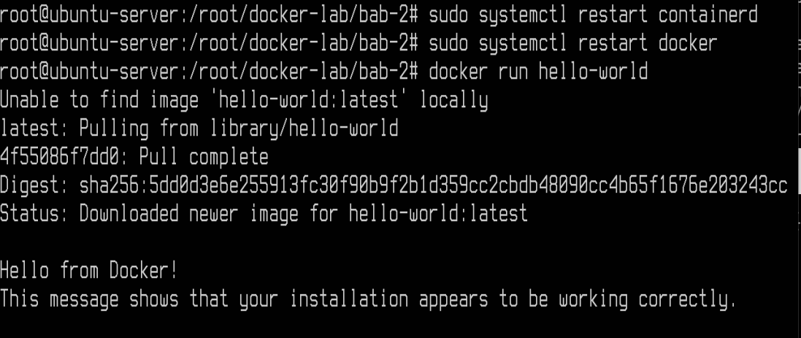
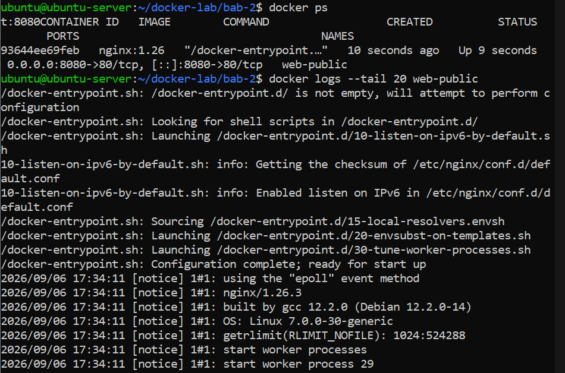
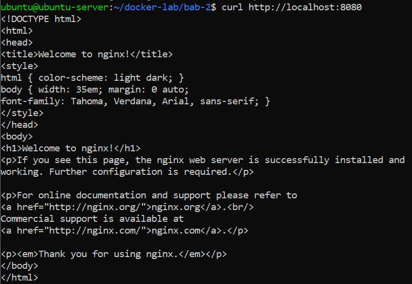
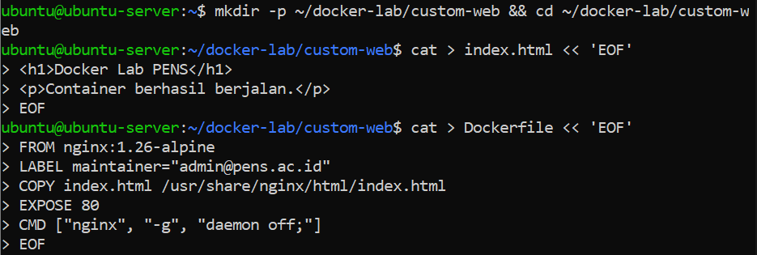
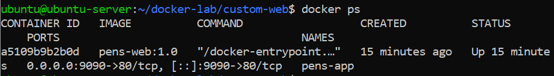
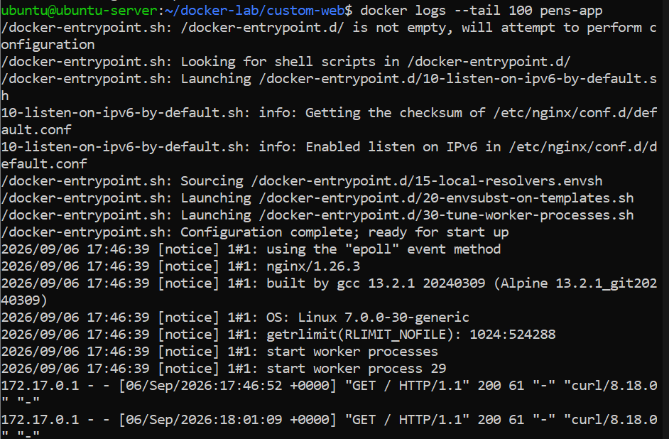
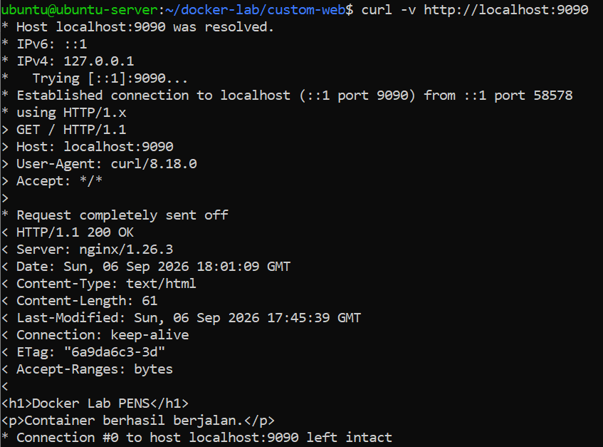
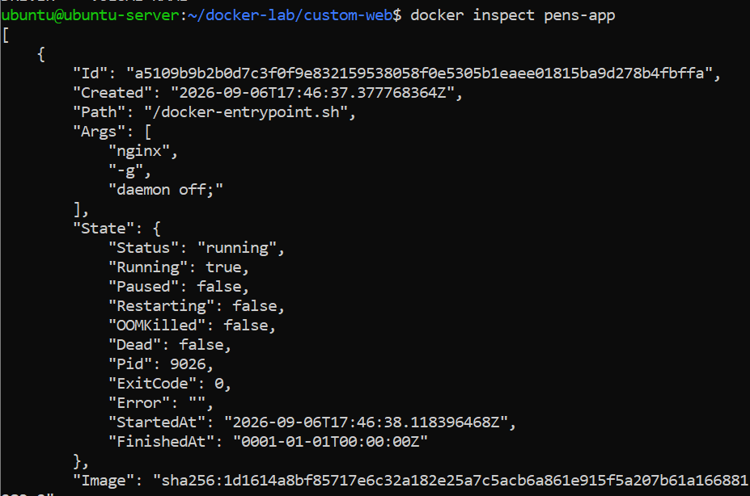

# Praktikum 2 - Pengenalan dan Penggunaan Docker

**Nama:** Ahmad Ari Fauzi  
**NRP:** 3126640009  

---

### 1. Menginstal Paket Dasar
**Penjelasan:**  
Menginstal paket dasar untuk mengunduh repository secara aman

**Command:**
```bash
sudo apt install -y ca-certificates curl gnupg lsb-release
```

---

### 2. Membuat Direktori dan Mengunduh Kunci GPG Docker
**Penjelasan:**  
Membuat direktori penyimpanan kunci, mengunduh kunci GPG resmi milik Docker, serta mengubah hak akses kunci agar dapat dibaca oleh sistem untuk proses verifikasi paket repository. 

**Command:**
```bash
sudo install -m 0755 -d /etc/apt/keyrings
curl -fsSL https://download.docker.com/linux/ubuntu/gpg | sudo gpg --dearmor -o /etc/apt/keyrings/docker.gpg
sudo chmod a+r /etc/apt/keyrings/docker.gpg
```

---

### 3. Mengetes Docker
**Penjelasan:**  
Menambahkan repository resmi Docker ke dalam daftar sumber aplikasi APT. Menginstal inti aplikasi Docker Engine. Memasukkan pengguna aktif ke dalam grup docker agar perintah Docker dapat dijalankan tanpa perlu mengetikkan sudo. Lalu cek versi docker untuk melihat apakah docker berhasil dijalankan. JIka sudah terinstall cek pembuatan container bisa atau tidak

**Command:**
```bash
echo "deb [arch=$(dpkg --print-architecture) signed-by=/etc/apt/keyrings/docker.gpg] https://download.docker.com/linux/ubuntu $(lsb_release -cs) stable" |   sudo tee /etc/apt/sources.list.d/docker.list > /dev/null
sudo apt update
sudo apt install -y docker-ce docker-ce-cli containerd.io docker-buildx-plugin docker-compose-plugin
sudo usermod -aG docker $USER
newgrp docker
docker version
docker run hello-world
```

**Output:**  


---

### 4. Menjalankan Container NGINX Publik
**Penjelasan:**  
Melakukan ekstraksi layer image NGINX dan menjalankan container NGINX di latar belakang dengan nama `web-public` serta melakukan port forwarding dari port 8080 host ke port 80 container, lalu memeriksa container yang berjalan. Setelah itu dilakukan cek container dan log untuk memastikan proses worker berjalan normal. 

**Command:**
```bash
docker pull nginx:1.26
docker run -d --name web-public -p 8080:80 nginx:1.26
docker ps
docker logs --tail 20 web-public
```

**Output:**  


---

### 5. Menguji Koneksi Web Server dengan curl
**Penjelasan:**  
Mengirimkan permintaan HTTP GET ke `localhost:8080` untuk memastikan halaman default NGINX ("Welcome to nginx!") merespons dengan baik. Jika sudah sesuai container bisa dihapus menggunakan perintah rm

**Command:**
```bash
curl -I http://localhost:8080
docker rm -f web-public ubuntu-test
```

**Output:**  


---

### 6. Membuat Custom Docker Image
**Penjelasan:**  
Membuat file `index.html` dan `Dockerfile` berbasis `nginx:1.26-alpine` untuk membangun custom image `pens-web:1.0`.

**Command:**
```bash
mkdir -p custom-web && cd custom-web
cat > index.html << 'EOF'
<h1>Docker Lab PENS</h1>
<p>Container berhasil berjalan.</p>
EOF
cat > Dockerfile << 'EOF'
FROM nginx:1.26-alpine
LABEL maintainer="admin@pens.ac.id"
COPY index.html /usr/share/nginx/html/index.html
EXPOSE 80
CMD ["nginx", "-g", "daemon off;"]
EOF
docker build -t pens-web:1.0 .
```

**Output:**  


---

### 7. Menjalankan Container Pens-App
**Penjelasan:**  
Menjalankan container baru `pens-app` pada port 9090 dan memeriksa statusnya menggunakan `docker ps`.

**Command:**
```bash
docker run -d --name pens-app -p 9090:80 pens-web:1.0
docker ps
```

**Output:**  


---

### 8. Menampilkan Log Aktivitas Server Pens-App
**Penjelasan:**  
Menampilkan log aktivitas container `pens-app` untuk memantau request yang masuk.

**Command:**
```bash
docker logs --tail 100 pens-app
```

**Output:**  


---

### 9. Menguji Koneksi Web Server dengan Mode Verbose
**Penjelasan:**  
Menguji koneksi ke `localhost:9090` menggunakan `curl` dengan mode verbose (`-v`) untuk melihat header HTTP lengkap beserta body dokumen HTML-nya.

**Command:**
```bash
curl -v http://localhost:9090
```

**Output:**  


---

### 10. Menampilkan Konfigurasi Container dalam Format JSON
**Penjelasan:**  
Menampilkan konfigurasi lengkap dari container `pens-app` dalam format JSON menggunakan `docker inspect`.

**Command:**
```bash
docker inspect pens-app
```

**Output:**  

