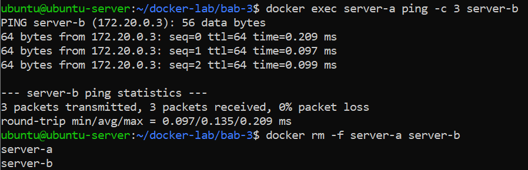
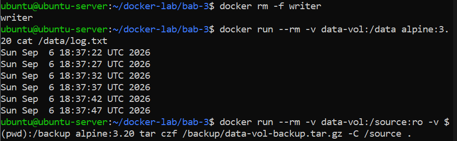
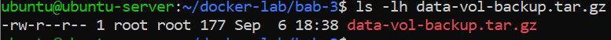
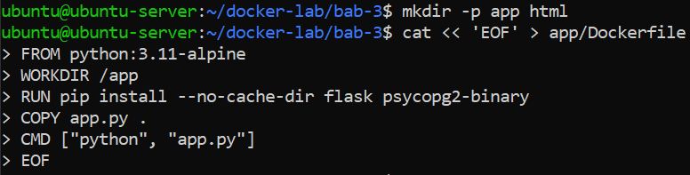
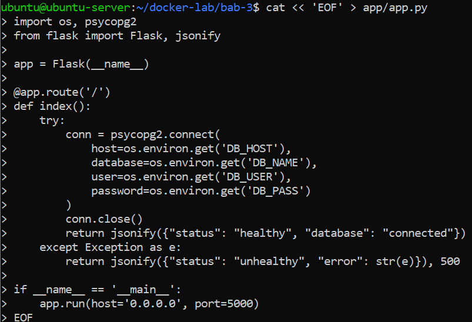
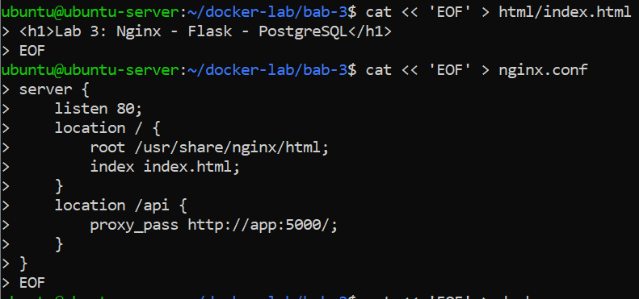
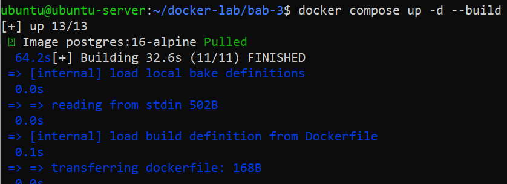
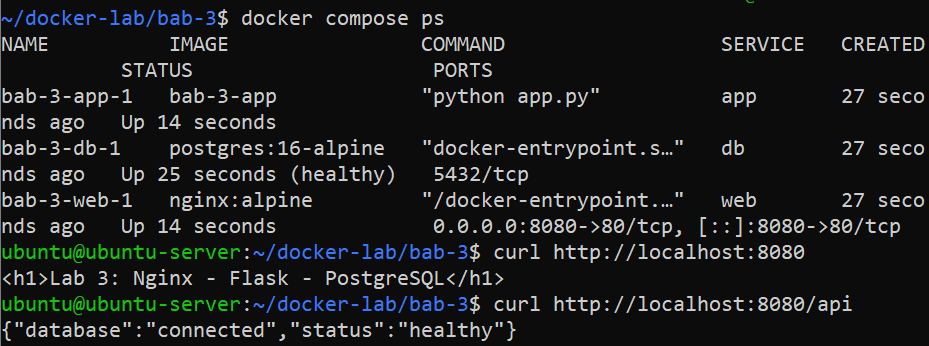

# Praktikum 3 - Docker Networking, Volumes, and Docker Compose

**Nama:** Ahmad Ari Fauzi  
**NRP:** 3126640009  

---

### 1. Membuat Direktori Kerja Bab 3
**Penjelasan:**  
Membuat folder baru untuk praktikum Bab 3 dan masuk ke dalam direktori tersebut.

**Command:**
```bash
mkdir -p ~/docker-lab/bab-3
cd ~/docker-lab/bab-3
```

---

### 2. Membuat Jaringan Kustom Docker (Custom Bridge Network)
**Penjelasan:**  
Membuat jaringan lokal Docker baru (custom bridge network) bernama `lab-net` dengan subnet `172.20.0.0/16`.

**Command:**
```bash
docker network create --driver bridge --subnet 172.20.0.0/16 lab-net
```

---

### 3. Menjalankan Container Server-A dan Server-B
**Penjelasan:**  
Menjalankan dua container (`server-a` dan `server-b`) menggunakan image `nginx:alpine` yang terhubung ke jaringan `lab-net`.

**Command:**
```bash
docker run -d --name server-a --network lab-net nginx:alpine
docker run -d --name server-b --network lab-net nginx:alpine
```

---

### 4. Pengujian Konektivitas Antar Container (Ping)
**Penjelasan:**  
Melakukan pengujian packet loss dari `server-a` ke `server-b` menggunakan perintah ping. Terlihat bahwa paket berhasil 100% terkirim, lalu membersihkan container.

**Command:**
```bash
docker exec server-a ping -c 3 server-b
docker rm -f server-a server-b
```

**Output:**  


---

### 5. Manajemen Docker Volume dan Data Persistence
**Penjelasan:**  
Membuat volume `data-vol` dan menjalankan container `writer` yang menuliskan stempel waktu ke file `/app/data/log.txt` setiap 5 detik. Setelah dibebaskan, container dihentikan dan dibaca isinya menggunakan container sementara.

**Command:**
```bash
docker volume create data-vol
docker run -d --name writer -v data-vol:/app/data alpine:3.20 sh -c "while true; do date >> /app/data/log.txt; sleep 5; done"
sleep 15
docker rm -f writer
docker run --rm -v data-vol:/data alpine:3.20 cat /data/log.txt
```

**Output:**  


---

### 6. Melakukan Backup Volume ke Arsip TAR
**Penjelasan:**  
Menjalankan container sementara untuk mengompres seluruh isi `data-vol` menjadi file arsip `data-vol-backup.tar.gz` di folder host saat ini.

**Command:**
```bash
docker run --rm -v data-vol:/source:ro -v $(pwd):/backup alpine:3.20 tar czf /backup/data-vol-backup.tar.gz -C /source .
ls -lh data-vol-backup.tar.gz
```

**Output:**  


---

### 7. Membuat Struktur Aplikasi (Flask App & NGINX)
**Penjelasan:**  
Membuat direktori aplikasi dan file `Dockerfile` untuk aplikasi Flask.

**Command:**
```bash
mkdir -p app html
cat << 'EOF' > app/Dockerfile
FROM python:3.11-alpine
WORKDIR /app
RUN pip install --no-cache-dir flask psycopg2-binary
COPY app.py .
CMD ["python", "app.py"]
EOF
```

**Output:**  


---

### 8. Membuat Kode Aplikasi Flask (app.py)
**Penjelasan:**  
Membuat script Python `app/app.py` yang terhubung ke database PostgreSQL dan mengembalikan respons JSON.

**Command:**
```bash
cat << 'EOF' > app/app.py
import os, psycopg2
from flask import Flask, jsonify

app = Flask(__name__)

@app.route('/')
def index():
    try:
        conn = psycopg2.connect(
            host=os.environ.get('DB_HOST'),
            database=os.environ.get('DB_NAME'),
            user=os.environ.get('DB_USER'),
            password=os.environ.get('DB_PASS')
        )
        conn.close()
        return jsonify({"status": "healthy", "database": "connected"})
    except Exception as e:
        return jsonify({"status": "unhealthy", "error": str(e)}), 500

if __name__ == '__main__':
    app.run(host='0.0.0.0', port=5000)
EOF
```

**Output:**  


---

### 9. Membuat Konfigurasi HTML dan NGINX Reverse Proxy
**Penjelasan:**  
16.	Membuat html/index.html dengan halaman sederhana dan membuat nginx.conf yang mengatur reverse proxy: akses ke / akan mengarah ke file HTML statis, sedangkan rute /api diforward ke layanan backend `http://app:5000/`.

**Command:**
```bash
cat << 'EOF' > html/index.html
<h1>Lab 3: Nginx - Flask - PostgreSQL</h1>
EOF

cat << 'EOF' > nginx.conf
server {
    listen 80;
    location / {
        root /usr/share/nginx/html;
        index index.html;
    }
    location /api {
        proxy_pass http://app:5000/;
    }
}
EOF
```

**Output:**  


---

### 10. Membuat File Konfigurasi Docker Compose (docker-compose.yml)
**Penjelasan:**  
Mendefinisikan service `web` dan `app` beserta environment variables dan network pada `docker-compose.yml`. Menambahkan service `db` (PostgreSQL 16 Alpine) dengan healthcheck (`pg_isready`) serta mendefinisikan volumes dan networks.

**Command:**
```bash
cat << 'EOF' > docker-compose.yml
services:
  web:
    image: nginx:alpine
    ports:
      - "8080:80"
    volumes:
      - ./html:/usr/share/nginx/html:ro
      - ./nginx.conf:/etc/nginx/conf.d/default.conf:ro
    networks: [frontend]
    depends_on: [app]
  app:
    build: ./app
    environment:
      DB_HOST: db
      DB_NAME: labdb
      DB_USER: labuser
      DB_PASS: labpass123
    networks: [frontend, backend]
    depends_on:
      db:
        condition: service_healthy
  db:
    image: postgres:16-alpine
    environment:
      POSTGRES_DB: labdb
      POSTGRES_USER: labuser
      POSTGRES_PASSWORD: labpass123
    volumes:
      - pg-data:/var/lib/postgresql/data
    networks: [backend]
    healthcheck:
      test: ["CMD-SHELL", "pg_isready -U labuser -d labdb"]
      interval: 5s
      timeout: 5s
      retries: 5
volumes:
  pg-data:
networks:
  frontend:
  backend:
EOF
```

---

### 11. Menjalankan Docker Compose (Build & Up)
**Penjelasan:**  
Merakit image aplikasi dan menjalankan seluruh service secara bersamaan di latar belakang.

**Command:**
```bash
docker compose up -d --build
```

**Output:**  


---

### 12. Pengujian Akhir Service dan API
**Penjelasan:**  
Memeriksa status container yang berjalan (`docker compose ps`), menguji halaman web statis, serta mengakses endpoint `/api`.

**Command:**
```bash
docker compose ps
curl http://localhost:8080
curl http://localhost:8080/api
```

**Output:**  

