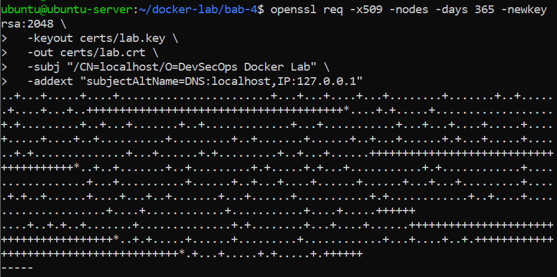
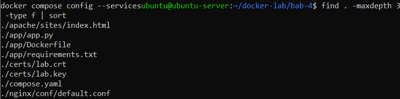
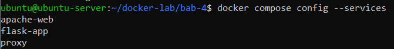
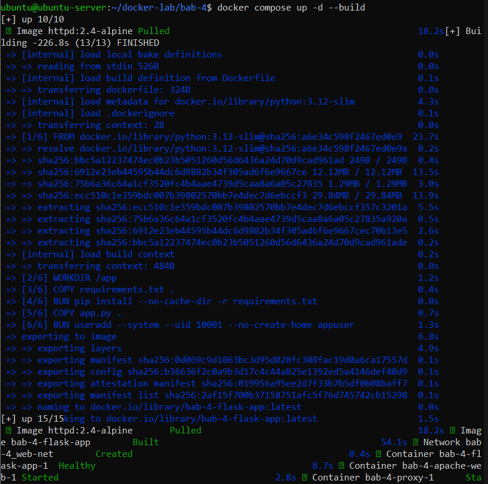
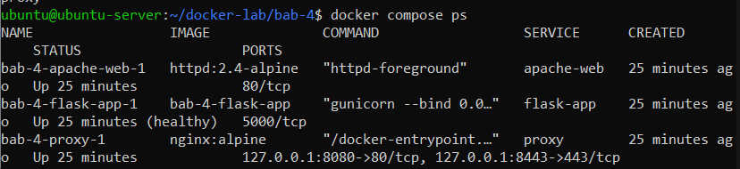
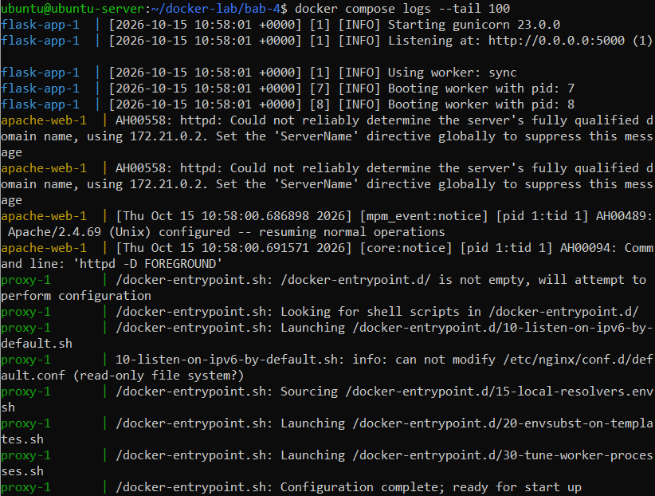
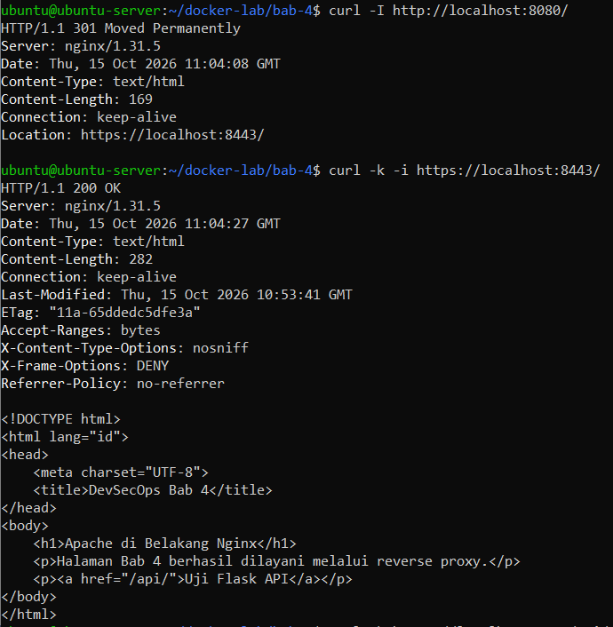
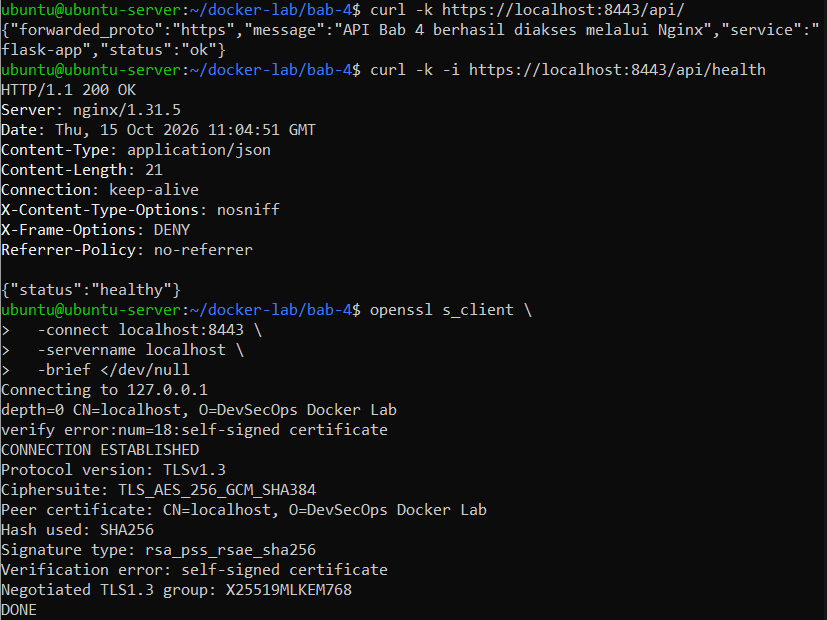
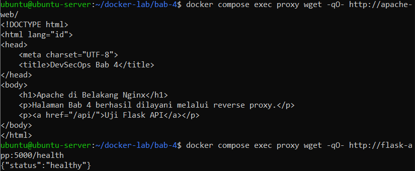

# Praktikum 4 - Secure Dockerized Multi-Container Architecture with TLS and Reverse Proxy

**Nama:** Ahmad Ari Fauzi  
**NRP:** 3126640009  

---

### 1. Membuat Direktori Kerja Bab 4
**Penjelasan:**  
Membuat direktori kerja untuk praktikum Bab 4 beserta folder pendukung untuk sertifikat SSL, aplikasi, dan konfigurasi NGINX.

**Command:**
```bash
mkdir -p ~/docker-lab/bab-4/{certs,app,apache/sites,nginx/conf}
cd ~/docker-lab/bab-4
```

---

### 2. Membuat Sertifikat SSL Self-Signed
**Penjelasan:**  
Menghasilkan sertifikat SSL self-signed dan private key menggunakan `openssl` untuk mengamankan komunikasi HTTPS, serta mengatur hak akses file kunci agar aman (`chmod 600`).

**Command:**
```bash
openssl req -x509 -nodes -days 365 -newkey rsa:2048 \
  -keyout certs/lab.key \
  -out certs/lab.crt \
  -subj "/CN=localhost/O=DevSecOps Docker Lab" \
  -addext "subjectAltName=DNS:localhost,IP:127.0.0.1"
chmod 600 certs/lab.key
chmod 644 certs/lab.crt
```

**Output:**  


---

### 3. Membuat Konfigurasi NGINX Reverse Proxy (default.conf)
**Penjelasan:**  
Mengonfigurasi NGINX sebagai reverse proxy dengan mengaktifkan TLS/SSL pada port 443, menambahkan security headers, serta meneruskan lalu lintas (proxy_pass) ke backend Apache dan Flask.

**Command:**
```bash
cat << 'EOF' > nginx/conf/default.conf
upstream apache_backend {
    server apache-web:80;
}

upstream flask_backend {
    server flask-app:5000;
}

server {
    listen 80;
    server_name localhost;
    return 301 https://$host:8443$request_uri;
}

server {
    listen 443 ssl;
    server_name localhost;

    ssl_certificate     /etc/nginx/certs/lab.crt;
    ssl_certificate_key /etc/nginx/certs/lab.key;
    ssl_protocols TLSv1.2 TLSv1.3;

    add_header X-Content-Type-Options "nosniff" always;
    add_header X-Frame-Options "DENY" always;
    add_header Referrer-Policy "no-referrer" always;

    location / {
        proxy_pass http://apache_backend;
        proxy_set_header Host $host;
        proxy_set_header X-Real-IP $remote_addr;
        proxy_set_header X-Forwarded-For $proxy_add_x_forwarded_for;
        proxy_set_header X-Forwarded-Proto $scheme;
    }

    location /api {
        proxy_pass http://flask_backend/;
        proxy_set_header Host $host;
        proxy_set_header X-Real-IP $remote_addr;
        proxy_set_header X-Forwarded-For $proxy_add_x_forwarded_for;
        proxy_set_header X-Forwarded-Proto $scheme;
    }
}
EOF
```

---

### 4. Membuat File Docker Compose (compose.yaml)
**Penjelasan:**  
Membuat file deklaratif `compose.yaml` untuk mengelola seluruh service (`apache-web`, `flask-app`, `proxy`), pengaturan volume, healthcheck, dan jaringan terisolasi.

**Command:**
```bash
cat << 'EOF' > compose.yaml
services:
  proxy:
    image: nginx:alpine
    ports:
      - "127.0.0.1:8080:80"
      - "127.0.0.1:8443:443"
    volumes:
      - ./nginx/conf:/etc/nginx/conf.d:ro
      - ./certs:/etc/nginx/certs:ro
      - ./logs/nginx:/var/log/nginx
    networks:
      - web-net
    depends_on:
      apache-web:
        condition: service_started
      flask-app:
        condition: service_healthy

  apache-web:
    image: httpd:2.4-alpine
    volumes:
      - ./apache/sites:/usr/local/apache2/htdocs:ro
    networks:
      - web-net

  flask-app:
    build:
      context: ./app
    networks:
      - web-net
    healthcheck:
      test:
        - CMD
        - python
        - -c
        - "import urllib.request; urllib.request.urlopen('http://127.0.0.1:5000/health')"
      interval: 5s
      timeout: 3s
      retries: 5
      start_period: 5s

networks:
  web-net:
    driver: bridge
EOF
```

---

### 5. Membuat Halaman Web Statis (Apache)
**Penjelasan:**  
Membuat file HTML statis `apache/sites/index.html` yang akan dilayani oleh server Apache di belakang NGINX reverse proxy.

**Command:**
```bash
cat << 'EOF' > apache/sites/index.html
<!DOCTYPE html>
<html lang="id">
<head>
    <meta charset="UTF-8">
    <title>DevSecOps Bab 4</title>
</head>
<body>
    <h1>Apache di Belakang Nginx</h1>
    <p>Halaman Bab 4 berhasil dilayani melalui reverse proxy.</p>
    <p><a href="/api/">Uji Flask API</a></p>
</body>
</html>
EOF
```

---

### 6. Membuat File Dependencies Aplikasi Flask (requirements.txt)
**Penjelasan:**  
Membuat file `app/requirements.txt` untuk mendefinisikan pustaka Python yang dibutuhkan (`flask` dan `gunicorn`).

**Command:**
```bash
cat << 'EOF' > app/requirements.txt
flask==3.0.3
gunicorn==23.0.0
EOF
```

---

### 7. Membuat Kode Aplikasi Flask (app.py)
**Penjelasan:**  
Membuat file `app/app.py` yang menyediakan endpoint `/` dan `/health` untuk memeriksa kesehatan aplikasi backend.

**Command:**
```bash
cat << 'EOF' > app/app.py
from flask import Flask, jsonify

app = Flask(__name__)

@app.route('/api/')
def api_home():
    return jsonify({
        "status": "ok",
        "message": "API Bab 4 berhasil diakses melalui Nginx",
        "service": "flask-app",
        "forwarded_proto": "https"
    })

@app.route('/api/health')
def health():
    return jsonify({"status": "healthy"})
EOF
```

---

### 8. Membuat Secure Dockerfile untuk Aplikasi Flask (Non-Root User)
**Penjelasan:**  
Membuat `app/Dockerfile` menggunakan base image `python:3.12-slim`, membuat sistem pengguna non-root (`appuser`) untuk mitigasi risiko keamanan container breakout, serta menjalankan aplikasi menggunakan Gunicorn worker.

**Command:**
```bash
cat << 'EOF' > app/Dockerfile
FROM python:3.12-slim
WORKDIR /app
COPY requirements.txt .
RUN pip install --no-cache-dir -r requirements.txt
COPY app.py .
RUN useradd --system --uid 10001 --no-create-home appuser
USER appuser
EXPOSE 5000
CMD ["gunicorn", "--bind", "0.0.0.0:5000", "--workers", "2", "app:app"]
EOF
```

---

### 9. Memeriksa Struktur File Proyek
**Penjelasan:**  
Memastikan seluruh file konfigurasi dan kode sumber telah terbuat dengan lengkap pada direktori kerja Bab 4.

**Command:**
```bash
find . -maxdepth 3 -type f | sort
```

**Output:**  


---

### 10. Memeriksa Docker Compose
**Penjelasan:**  
Memeriksa konfigurasi akhir compose dan service yang didefinisikan di dalamnya

**Command:**
```bash
docker compose config
docker compose config --services
```

**Output:**  


---

### 11. Menjalankan Docker Compose
**Penjelasan:**  
Membangun image dan menjalankan seluruh container secara bersamaan di latar belakang menggunakan perintah `docker compose up -d --build`.

**Command:**
```bash
docker compose up -d --build
```

**Output:**  


---

### 12. Memeriksa Status Container yang Berjalan
**Penjelasan:**  
Melakukan verifikasi bahwa semua service (`apache-web`, `flask-app`, `proxy`) berada dalam status aktif dan sehat (`healthy`).

**Command:**
```bash
docker compose ps
```

**Output:**  


---

### 13. Menampilkan Log Container
**Penjelasan:**  
Memeriksa log aktivitas container untuk memastikan proses worker Gunicorn dan NGINX berjalan normal tanpa error.

**Command:**
```bash
docker compose logs --tail 100
```

**Output:**  


---

### 14. Pengujian Akhir Endpoint HTTPS via cURL
**Penjelasan:**  
menguji apakah layanan HTTPS di port 8443 sudah aktif dan berhasil menampilkan halaman web Apache menggunakan self-signed certificate. Opsi -k mengabaikan peringatan sertifikat yang tidak valid, sedangkan -i menampilkan header respons bersama halaman webnya.

**Command:**
```bash
curl -I http://localhost:8080/
curl -k -i https://localhost:8443/

```

**Output:**  


---

### 15. Pengujian Akhir Endpoint HTTPS via cURL
**Penjelasan:**  
Menguji endpoint API melalui HTTPS dengan mode insecure (`-k`) untuk memverifikasi respons JSON dari Flask API yang melalui NGINX reverse proxy. Menguji koneksi TLS/Cipher suite menggunakan utilitas `openssl s_client` ke port HTTPS `8443`.

**Command:**
```bash
curl -k https://localhost:8443/api/
curl -k -i https://localhost:8443/api/health
openssl s_client \
  -connect localhost:8443 \
  -servername localhost \
  -brief </dev/null
```

**Output:**  


---

### 16. Menguji Akses Reverse Proxy dan API Endpoint dari Dalam Container Proxy
**Penjelasan:**  
Menguji konektivitas internal menggunakan `wget` dari container proxy ke backend Apache dan Flask API.

**Command:**
```bash
docker compose exec proxy wget -qO- http://apache-web/
docker compose exec proxy wget -qO- http://flask-app:5000/api/health
```

**Output:**  


---


