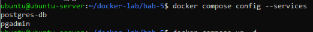
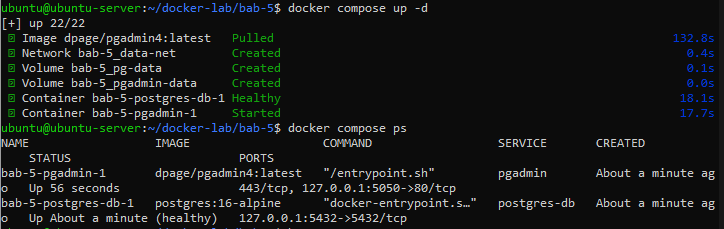
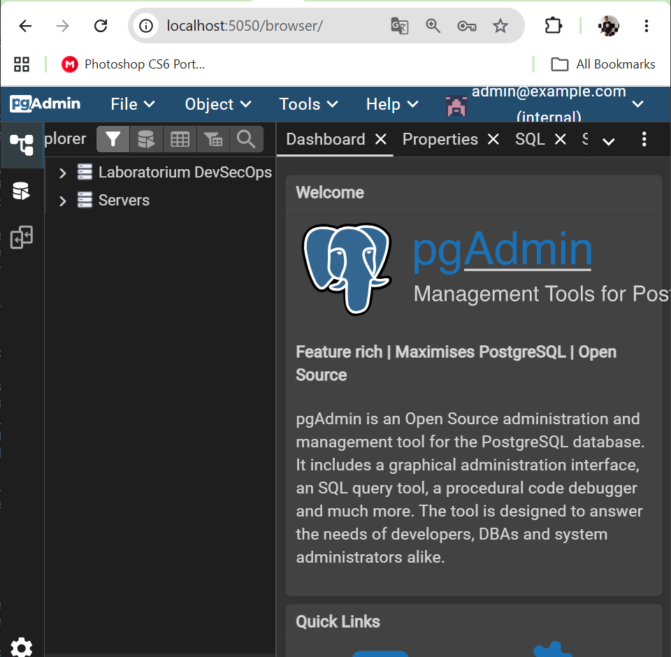
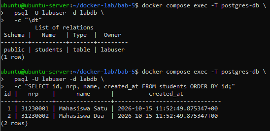
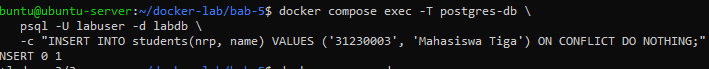
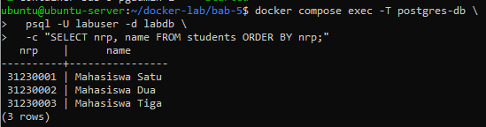
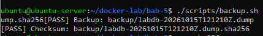
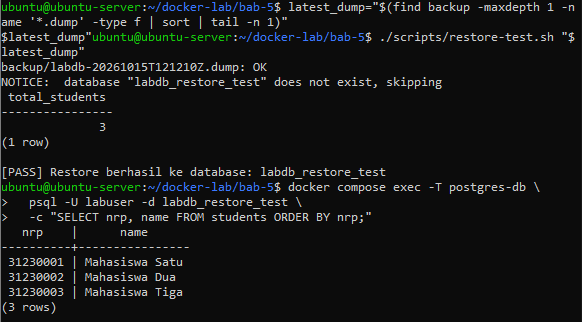

# Praktikum 5 - Database Containerization, Automated Backup, Security Hardening, and Management with pgAdmin

**Nama:** Ahmad Ari Fauzi  
**NRP:** 3126640009  

---

### 1. Membuat Direktori Kerja Bab 5
**Penjelasan:**  
Membuat direktori kerja untuk praktikum Bab 5 beserta subfolder `init`, `backup`, `pgadmin`, dan `scripts`.

**Command:**
```bash
mkdir -p ~/docker-lab/bab-5/{init,backup,pgadmin,scripts}
cd ~/docker-lab/bab-5
```

---

### 2. Membuat File Variabel Lingkungan (.env.example & .env)
**Penjelasan:**  
Membuat file template `.env.example` dan menyalinnya menjadi `.env` untuk menyimpan kredensial sensitif secara aman terpisah dari file Compose.

**Command:**
```bash
cat << 'EOF' > .env.example
POSTGRES_DB=labdb
POSTGRES_USER=labuser
POSTGRES_PASSWORD=labpass123
PGADMIN_DEFAULT_EMAIL=admin@example.com
PGADMIN_DEFAULT_PASSWORD=admin123
EOF

cp .env.example .env
chmod 600 .env
```

---

### 3. Membuat Konfigurasi Gitignore (.gitignore)
**Penjelasan:**  
Membuat file `.gitignore` untuk mencegah file kredensial `.env` dan file dump backup terunggah ke repositori Git.

**Command:**
```bash
cat << 'EOF' > .gitignore
.env
backup/*.dump
backup/*.sha256
backup/*.log
EOF
```

---

### 4. Membuat File Docker Compose (compose.yaml)
**Penjelasan:**  
Membuat file deklaratif `compose.yaml` yang menggunakan environment variables dari file `.env`, membatasi binding port database ke `127.0.0.1` demi keamanan, serta menyertakan healthcheck PostgreSQL.

**Command:**
```bash
cat << 'EOF' > compose.yaml
services:
  postgres-db:
    image: postgres:16-alpine
    environment:
      POSTGRES_DB: ${POSTGRES_DB}
      POSTGRES_USER: ${POSTGRES_USER}
      POSTGRES_PASSWORD: ${POSTGRES_PASSWORD}
    ports:
      - "127.0.0.1:5432:5432"
    volumes:
      - pg-data:/var/lib/postgresql/data
      - ./init:/docker-entrypoint-initdb.d:ro
    networks:
      - data-net
    healthcheck:
      test: ["CMD-SHELL", "pg_isready -U ${POSTGRES_USER} -d ${POSTGRES_DB}"]
      interval: 5s
      timeout: 5s
      retries: 10
      start_period: 10s
    restart: unless-stopped

  pgadmin:
    image: dpage/pgadmin4:latest
    environment:
      PGADMIN_DEFAULT_EMAIL: ${PGADMIN_DEFAULT_EMAIL}
      PGADMIN_DEFAULT_PASSWORD: ${PGADMIN_DEFAULT_PASSWORD}
    ports:
      - "127.0.0.1:5050:80"
    volumes:
      - pgadmin-data:/var/lib/pgadmin
      - ./pgadmin/servers.json:/pgadmin4/servers.json:ro
    networks:
      - data-net
    depends_on:
      postgres-db:
        condition: service_healthy
    restart: unless-stopped

volumes:
  pg-data:
  pgadmin-data:

networks:
  data-net:
    driver: bridge
EOF
```

---

### 5. Membuat Skema Inisialisasi Database (init/01-schema.sql)
**Penjelasan:**  
Membuat file SQL inisialisasi tabel `students` yang akan dieksekusi secara otomatis saat container PostgreSQL pertama kali dibuat.

**Command:**
```bash
cat << 'EOF' > init/01-schema.sql
CREATE TABLE IF NOT EXISTS students (
    id BIGSERIAL PRIMARY KEY,
    nrp VARCHAR(20) UNIQUE NOT NULL,
    name TEXT NOT NULL,
    created_at TIMESTAMPTZ NOT NULL DEFAULT CURRENT_TIMESTAMP
);

INSERT INTO students (nrp, name)
VALUES
    ('31230001', 'Mahasiswa Satu'),
    ('31230002', 'Mahasiswa Dua')
ON CONFLICT (nrp) DO NOTHING;

CREATE INDEX IF NOT EXISTS idx_students_name
    ON students (name);
EOF
```

---

### 6. Membuat File Konfigurasi pgAdmin (pgadmin/servers.json)
**Penjelasan:**  
Membuat file `pgadmin/servers.json` agar pgAdmin dapat melakukan otomatisasi pendaftaran server PostgreSQL.

**Command:**
```bash
cat << 'EOF' > pgadmin/servers.json
{
    "Servers": {
        "1": {
            "Name": "PostgreSQL Bab 5",
            "Group": "Laboratorium DevSecOps",
            "Host": "postgres-db",
            "Port": 5432,
            "MaintenanceDB": "labdb",
            "Username": "labuser",
            "SSLMode": "prefer"
        }
    }
}
EOF
```

---

### 7. Membuat Skrip Automated Backup (scripts/backup.sh)
**Penjelasan:**  
Membuat skrip Bash `scripts/backup.sh` untuk melakukan backup database secara otomatis menggunakan `pg_dump`, melakukan kompresi, menghasilkan checksum SHA256, serta menerapkan kebijakan retensi.

**Command:**
```bash
cat << 'EOF' > scripts/backup.sh
#!/usr/bin/env bash
set -Eeuo pipefail

cd "$(dirname "$0")/.."

if [[ ! -f .env ]]; then
    echo "[FAIL] File .env tidak ditemukan." >&2
    exit 1
fi

set -a
source .env
set +a

mkdir -p backup
timestamp="$(date -u +"%Y%m%dT%H%M%SZ")"
backup_file="backup/${POSTGRES_DB}-${timestamp}.dump"

echo "[INFO] Memulai backup database ${POSTGRES_DB}..."

docker compose exec -T postgres-db \
  pg_dump \
  --username "${POSTGRES_USER}" \
  --dbname "${POSTGRES_DB}" \
  --format=custom \
  --compress=9 \
  > "${backup_file}"

sha256sum "${backup_file}" > "${backup_file}.sha256"

echo "[PASS] Backup: ${backup_file}"
echo "[PASS] Checksum: ${backup_file}.sha256"
EOF
```

---

### 8. Membuat Skrip Disaster Recovery & Restore Test (scripts/restore-test.sh)
**Penjelasan:**  
Membuat skrip Bash `scripts/restore-test.sh` untuk menguji integritas file backup dengan melakukan verifikasi checksum SHA256 dan memulihkan database ke lingkungan pengujian terisolasi.

**Command:**
```bash
cat << 'EOF' > scripts/restore-test.sh
#!/usr/bin/env bash
set -Eeuo pipefail

cd "$(dirname "$0")/.."

if [[ ! -f .env ]]; then
    echo "[FAIL] File .env tidak ditemukan." >&2
    exit 1
fi

set -a
source .env
set +a

dump_file="${1:-}"
restore_database="${POSTGRES_DB}_restore_test"

if [[ -z "$dump_file" || ! -s "$dump_file" ]]; then
    echo "Penggunaan: $0 backup/nama-file.dump" >&2
    exit 1
fi

if [[ -f "${dump_file}.sha256" ]]; then
    sha256sum --check "${dump_file}.sha256"
fi

docker compose exec -T postgres-db \
  dropdb --username "${POSTGRES_USER}" --if-exists "$restore_database"

docker compose exec -T postgres-db \
  createdb --username "${POSTGRES_USER}" "$restore_database"

docker compose exec -T postgres-db \
  pg_restore \
  --username "${POSTGRES_USER}" \
  --dbname "$restore_database" \
  --no-owner \
  --no-privileges \
  < "$dump_file"

docker compose exec -T postgres-db \
  psql \
  --username "${POSTGRES_USER}" \
  --dbname "$restore_database" \
  --command "SELECT COUNT(*) AS total_students FROM students;"

echo "[PASS] Restore berhasil ke database: $restore_database"
EOF
```

---

### 9. Memberikan Hak Akses dan Memeriksa Konfigurasi Docker Compose
**Penjelasan:**  
Memberikan hak eksekusi (`chmod +x`) pada skrip backup dan restore, lalu memverifikasi validitas file `compose.yaml` menggunakan perintah `docker compose config --services`.

**Command:**
```bash
chmod +x scripts/backup.sh scripts/restore-test.sh
docker compose config --services
```

**Output:**  


---

### 10. Menjalankan Docker Compose
**Penjelasan:**  
Mengunduh image dan menjalankan service `postgres-db` dan `pgadmin` di latar belakang dengan perintah `docker compose up -d`.

**Command:**
```bash
docker compose up -d
docker compose ps
```

**Output:**  


---

### 11. Akses Manajemen pgAdmin via SSH Tunnel
**Penjelasan:**  
Mengakses antarmuka manajemen web pgAdmin di `http://localhost:5050` melalui SSH port forwarding (`ssh -L 5050:127.0.0.1:5050`) dari komputer host (karena disini menggunakan vm). Dan akses ip dari browser laptop

**Command:**
```bash
ssh -L 5050:127.0.0.1:5050 ubuntu@<server-ip>
```

**Output:**  


---

### 12. Memverifikasi Isi Database PostgreSQL
**Penjelasan:**  
Masuk ke dalam container PostgreSQL untuk memeriksa tabel `students` dan data awal yang dimasukkan saat inisialisasi.

**Command:**
```bash
docker compose exec -T postgres-db \
  psql -U labuser -d labdb \
  -c "\dt"

docker compose exec -T postgres-db \
  psql -U labuser -d labdb \
  -c "SELECT id, nrp, name, created_at FROM students ORDER BY id;"
```

**Output:**  


---

### 13. Menambahkan Data Baru ke Database
**Penjelasan:**  
Menjalankan perintah SQL insert untuk menambahkan data mahasiswa baru ke dalam tabel `students`.

**Command:**
```bash
docker compose exec -T postgres-db \
  psql -U labuser -d labdb \
  -c "INSERT INTO students(nrp, name) VALUES ('31230003', 'Mahasiswa Tiga') ON CONFLICT DO NOTHING;"
```

**Output:**  


---

### 14. Menguji Persistensi Volume
**Penjelasan:**  
Proses tersebut merestart container menggunakan `down` dan `up -d`, lalu membuktikan bahwa data mahasiswa tetap aman dan tidak hilang dengan menampilkan daftar NRP serta nama dari PostgreSQL.

**Command:**
```bash
docker compose down
docker compose up -d
docker compose exec -T postgres-db \
  psql -U labuser -d labdb \
  -c "SELECT nrp, name FROM students ORDER BY nrp;"
```

**Output:**  


---

### 15. Menjalankan Skrip Backup dan Restore Test
**Penjelasan:**  
 Menjalankan skrip backup untuk menghasilkan dump database beserta checksum-nya.

**Command:**
```bash
./scripts/backup.sh
```

**Output:**  


---

### 16. Melakukan Uji Pemulihan (Restore Test)
**Penjelasan:**  
Menjalankan skrip `restore-test.sh` dengan file dump terbaru untuk memastikan proses disaster recovery berjalan sukses tanpa kendala. Setelah itu diperiksa hasil restore data

**Command:**
```bash
latest_dump=$(ls -t backup/*.dump | head -n 1)
./scripts/restore-test.sh "$latest_dump"
docker compose exec -T postgres-db \
  psql -U labuser -d labdb_restore_test \
  -c "SELECT nrp, name FROM students ORDER BY nrp;"
```

**Output:**  


---

