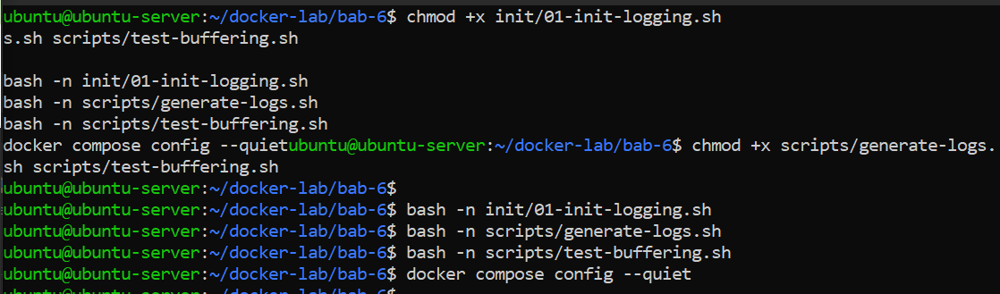
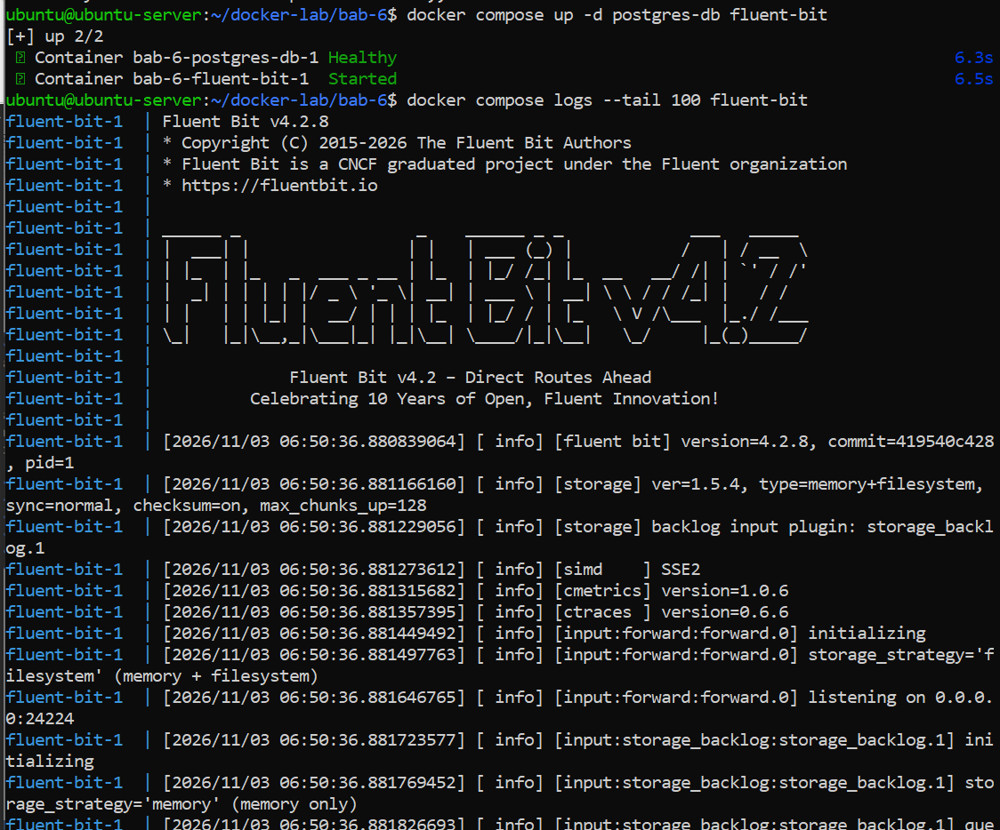
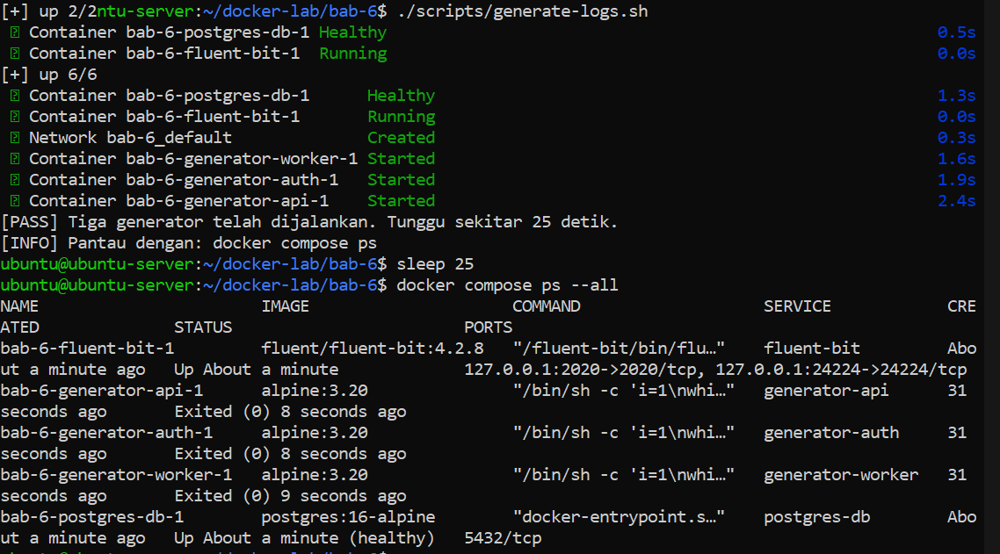
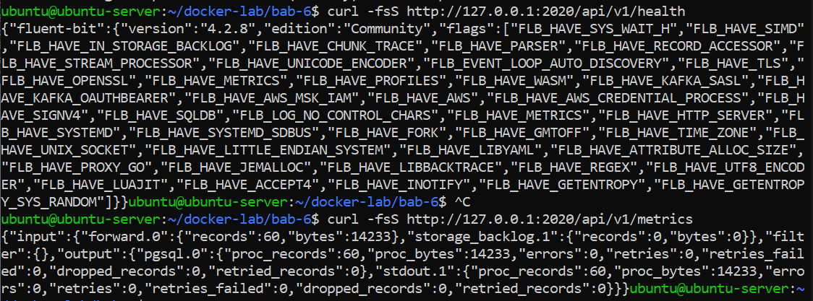
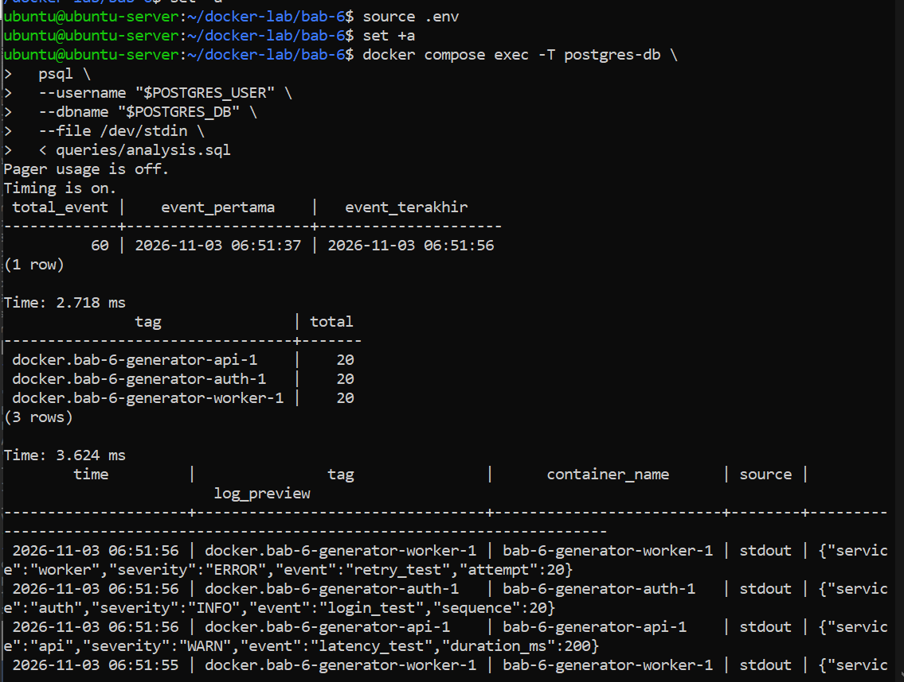
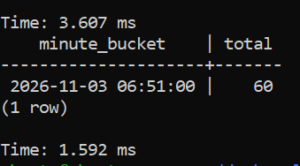
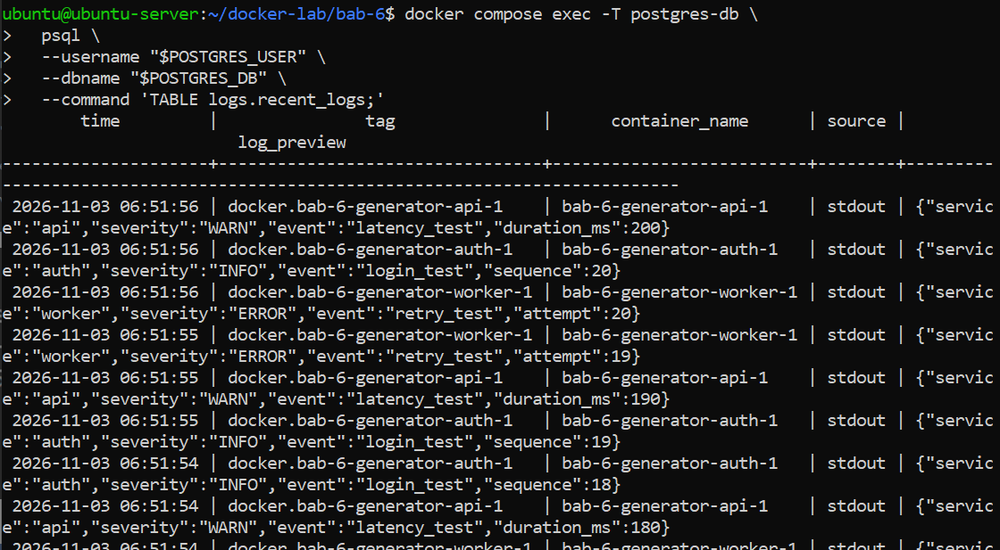
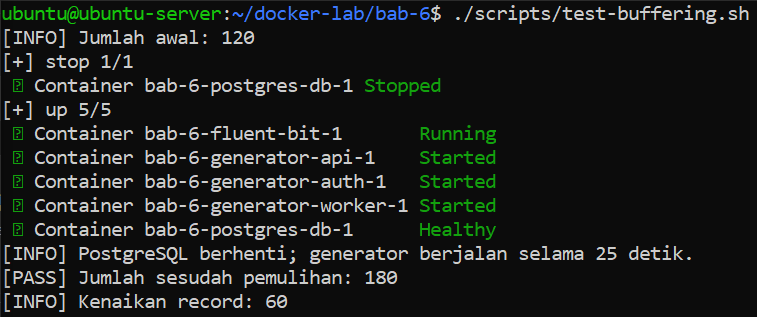
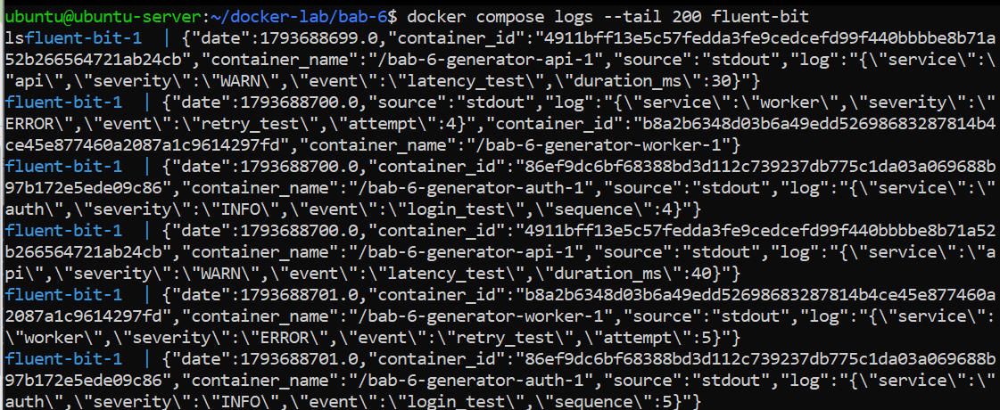
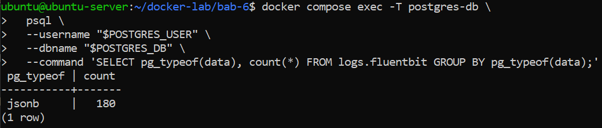

# Praktikum 6 - Advanced Docker Logging and Centralized Log Management with Fluent Bit and PostgreSQL

**Nama:** Ahmad Ari Fauzi  
**NRP:** 3126640009  

---

### 1. Membuat Direktori Kerja Bab 6
**Penjelasan:**  
Membuat direktori kerja untuk praktikum Bab 6 beserta subfolder `init`, `fluent-bit`, `queries`, dan `scripts`.

**Command:**
```bash
mkdir -p ~/docker-lab/bab-6/{init,fluent-bit,queries,scripts}
cd ~/docker-lab/bab-6
```

---

### 2. Membuat File Variabel Lingkungan (.env.example & .env)
**Penjelasan:**  
Membuat template file `.env.example` untuk konfigurasi kredensial database dan Fluent Bit, menyalinnya menjadi `.env`, serta mengatur hak akses `chmod 600`.

**Command:**
```bash
cat << 'EOF' > .env.example
POSTGRES_DB=labdb
POSTGRES_USER=labadmin
POSTGRES_PASSWORD=labadminpass123
FLUENTBIT_DB_USER=fluentbit_user
FLUENTBIT_DB_PASSWORD=fluentbitpass123
EOF

cp .env.example .env
chmod 600 .env
```

---

### 3. Membuat File Gitignore (.gitignore)
**Penjelasan:**  
Membuat file `.gitignore` untuk mencegah file sensitif `.env` dan file log terunggah ke repositori Git.

**Command:**
```bash
cat << 'EOF' > .gitignore
.env
*.log
reports/
EOF
```

---

### 4. Membuat File Docker Compose (compose.yaml)
**Penjelasan:**  
Membuat file deklaratif `compose.yaml` untuk mengelola service PostgreSQL dan Fluent Bit dengan konfigurasi volume, jaringan, serta healthcheck.

**Command:**
```bash
cat << 'EOF' > compose.yaml
services:
  postgres-db:
    image: postgres:16-alpine
    environment:
      POSTGRES_DB: ${POSTGRES_DB}
      POSTGRES_USER: ${POSTGRES_USER}
      POSTGRES_PASSWORD: ${POSTGRES_PASSWORD}
      FLUENTBIT_DB_USER: ${FLUENTBIT_DB_USER}
      FLUENTBIT_DB_PASSWORD: ${FLUENTBIT_DB_PASSWORD}
    volumes:
      - pg-data:/var/lib/postgresql/data
      - ./init:/docker-entrypoint-initdb.d:ro
    networks:
      - logging-net
    healthcheck:
      test:
        - CMD-SHELL
        - "pg_isready -U $${POSTGRES_USER} -d $${POSTGRES_DB}"
      interval: 5s
      timeout: 5s
      retries: 12
      start_period: 10s
    restart: unless-stopped

  fluent-bit:
    image: fluent/fluent-bit:4.2.8
    environment:
      POSTGRES_DB: ${POSTGRES_DB}
      FLUENTBIT_DB_USER: ${FLUENTBIT_DB_USER}
      FLUENTBIT_DB_PASSWORD: ${FLUENTBIT_DB_PASSWORD}
    volumes:
      - ./fluent-bit/fluent-bit.conf:/fluent-bit/etc/fluent-bit.conf:ro
      - flb-storage:/var/log/flb-storage
    ports:
      - "127.0.0.1:24224:24224"
      - "127.0.0.1:2020:2020"
    networks:
      - logging-net
    depends_on:
      postgres-db:
        condition: service_healthy
    security_opt:
      - no-new-privileges:true
    restart: unless-stopped

  generator-auth:
    image: alpine:3.20
    command:
      - /bin/sh
      - -c
      - |
        i=1
        while [ "$$i" -le 20 ]; do
          printf '{"service":"auth","severity":"INFO","event":"login_test","sequence":%s}\n' "$$i"
          i=$$((i + 1))
          sleep 1
        done
    logging:
      driver: fluentd
      options:
        fluentd-address: "127.0.0.1:24224"
        fluentd-async: "true"
        tag: "docker.{{.Name}}"
    depends_on:
      - fluent-bit

  generator-api:
    image: alpine:3.20
    command:
      - /bin/sh
      - -c
      - |
        i=1
        while [ "$$i" -le 20 ]; do
          printf '{"service":"api","severity":"WARN","event":"latency_test","duration_ms":%s}\n' "$$((i * 10))"
          i=$$((i + 1))
          sleep 1
        done
    logging:
      driver: fluentd
      options:
        fluentd-address: "127.0.0.1:24224"
        fluentd-async: "true"
        tag: "docker.{{.Name}}"
    depends_on:
      - fluent-bit

  generator-worker:
    image: alpine:3.20
    command:
      - /bin/sh
      - -c
      - |
        i=1
        while [ "$$i" -le 20 ]; do
          printf '{"service":"worker","severity":"ERROR","event":"retry_test","attempt":%s}\n' "$$i"
          i=$$((i + 1))
          sleep 1
        done
    logging:
      driver: fluentd
      options:
        fluentd-address: "127.0.0.1:24224"
        fluentd-async: "true"
        tag: "docker.{{.Name}}"
    depends_on:
      - fluent-bit

volumes:
  pg-data:
  flb-storage:

networks:
  logging-net:
    driver: bridge
EOF
```

---

### 5. Membuat Skrip Inisialisasi Database (init/01-init-logging.sh)
**Penjelasan:**  
Membuat skrip SQL inisialisasi otomatis untuk membuat schema, tabel, dan role user database PostgreSQL bagi Fluent Bit.

**Command:**
```bash
cat << 'EOF' > init/01-init-logging.sh
#!/usr/bin/env bash
set -Eeuo pipefail

: "${POSTGRES_USER:?POSTGRES_USER belum diatur}"
: "${POSTGRES_DB:?POSTGRES_DB belum diatur}"
: "${FLUENTBIT_DB_USER:?FLUENTBIT_DB_USER belum diatur}"
: "${FLUENTBIT_DB_PASSWORD:?FLUENTBIT_DB_PASSWORD belum diatur}"

psql \
  --set=ON_ERROR_STOP=1 \
  --username "$POSTGRES_USER" \
  --dbname "$POSTGRES_DB" \
  --set=fb_user="$FLUENTBIT_DB_USER" \
  --set=fb_password="$FLUENTBIT_DB_PASSWORD" <<'SQL'
SELECT format(
    'CREATE ROLE %I LOGIN PASSWORD %L',
    :'fb_user',
    :'fb_password'
)
WHERE NOT EXISTS (
    SELECT 1 FROM pg_roles WHERE rolname = :'fb_user'
)
\gexec

CREATE SCHEMA IF NOT EXISTS logs;

CREATE TABLE IF NOT EXISTS logs.fluentbit (
    tag  TEXT NOT NULL,
    time TIMESTAMP WITHOUT TIME ZONE NOT NULL,
    data JSONB NOT NULL
);

CREATE INDEX IF NOT EXISTS idx_fluentbit_time
    ON logs.fluentbit (time DESC);

CREATE INDEX IF NOT EXISTS idx_fluentbit_tag
    ON logs.fluentbit (tag);

CREATE INDEX IF NOT EXISTS idx_fluentbit_data_gin
    ON logs.fluentbit USING GIN (data);

CREATE OR REPLACE VIEW logs.recent_logs AS
SELECT
    time,
    tag,
    replace(data ->> 'container_name', '/', '') AS container_name,
    data ->> 'source' AS source,
    left(data ->> 'log', 200) AS log_preview
FROM logs.fluentbit
ORDER BY time DESC
LIMIT 100;

SELECT format(
    'ALTER ROLE %I IN DATABASE %I SET search_path TO logs, public',
    :'fb_user',
    current_database()
)
\gexec

SELECT format('GRANT USAGE, CREATE ON SCHEMA logs TO %I', :'fb_user')
\gexec

SELECT format(
    'GRANT SELECT, INSERT ON TABLE logs.fluentbit TO %I',
    :'fb_user'
)
\gexec

SELECT format('GRANT SELECT ON TABLE logs.recent_logs TO %I', :'fb_user')
\gexec
SQL
EOF
```

---

### 6. Membuat File Konfigurasi Fluent Bit (fluent-bit/fluent-bit.conf)
**Penjelasan:**  
Mengonfigurasi Fluent Bit input, storage buffer, dan output plugin PostgreSQL (`pg)`) untuk mengirimkan log ke database.

**Command:**
```bash
cat << 'EOF' > fluent-bit/fluent-bit.conf
[SERVICE]
    Flush                     1
    Daemon                    Off
    Log_Level                 info
    storage.path              /var/log/flb-storage
    storage.sync              normal
    storage.checksum          on
    storage.backlog.mem_limit 10M
    HTTP_Server               On
    HTTP_Listen               0.0.0.0
    HTTP_Port                 2020

[INPUT]
    Name          forward
    Listen        0.0.0.0
    Port          24224
    Mem_Buf_Limit 10M
    storage.type  filesystem

[OUTPUT]
    Name                     pgsql
    Match                    *
    Host                     postgres-db
    Port                     5432
    User                     ${FLUENTBIT_DB_USER}
    Password                 ${FLUENTBIT_DB_PASSWORD}
    Database                 ${POSTGRES_DB}
    Table                    fluentbit
    storage.total_limit_size 256M

[OUTPUT]
    Name   stdout
    Match  *
    Format json_lines
EOF
```

---

### 7. Membuat Kueri Analisis SQL (queries/analysis.sql)
**Penjelasan:**  
Membuat file kueri SQL untuk menganalisis log yang masuk berdasarkan rentang waktu, jumlah event per tag, dan preview pesan log.

**Command:**
```bash
cat << 'EOF' > queries/analysis.sql
\pset pager off
\timing on

-- 1. Jumlah event dan rentang waktu.
SELECT
    count(*) AS total_event,
    min(time) AS event_pertama,
    max(time) AS event_terakhir
FROM logs.fluentbit;

-- 2. Distribusi berdasarkan tag Docker.
SELECT
    tag,
    count(*) AS total
FROM logs.fluentbit
GROUP BY tag
ORDER BY total DESC, tag;

-- 3. Metadata terstruktur dari Docker logging driver.
SELECT
    time,
    tag,
    replace(data ->> 'container_name', '/', '') AS container_name,
    data ->> 'source' AS source,
    left(data ->> 'log', 160) AS log_preview
FROM logs.fluentbit
ORDER BY time DESC
LIMIT 15;

-- 4. Pencarian severity pada JSON yang masih berada di field log.
SELECT
    time,
    tag,
    data ->> 'log' AS log_message
FROM logs.fluentbit
WHERE data ->> 'log' ILIKE '%"severity":"ERROR"%'
ORDER BY time DESC;

-- 5. Ringkasan per menit untuk mengamati laju ingest.
SELECT
    date_trunc('minute', time) AS minute_bucket,
    count(*) AS total
FROM logs.fluentbit
GROUP BY minute_bucket
ORDER BY minute_bucket DESC
LIMIT 10;

-- Contoh retensi; tinjau dahulu sebelum menghapus data.
-- DELETE FROM logs.fluentbit
-- WHERE time < CURRENT_TIMESTAMP - INTERVAL '7 days';
EOF
```

---

### 8. Membuat Skrip Generator Log (scripts/generate-logs.sh)
**Penjelasan:**  
Membuat skrip bash untuk mensimulasikan container aplikasi (api, auth, worker) yang mengirimkan log terstruktur ke Fluent Bit.

**Command:**
```bash
cat << 'EOF' > scripts/generate-logs.sh
#!/usr/bin/env bash
set -Eeuo pipefail

cd "$(dirname "$0")/.."

if [[ ! -f .env ]]; then
    echo "[FAIL] File .env tidak ditemukan." >&2
    exit 1
fi

docker compose up -d postgres-db fluent-bit

for attempt in {1..30}; do
    if curl -fsS http://127.0.0.1:2020/api/v1/health >/dev/null; then
        break
    fi

    if [[ "$attempt" -eq 30 ]]; then
        echo "[FAIL] Endpoint kesehatan Fluent Bit belum siap." >&2
        exit 1
    fi
    sleep 2
done

docker compose up -d --force-recreate \
    generator-auth \
    generator-api \
    generator-worker

echo "[PASS] Tiga generator telah dijalankan. Tunggu sekitar 25 detik."
echo "[INFO] Pantau dengan: docker compose ps"
EOF
```

---

### 9. Membuat Skrip Pengujian Buffer (scripts/test-buffering.sh)
**Penjelasan:**  
Membuat skrip bash untuk menguji ketahanan buffer log saat database dimatikan dan dinyalakan kembali (*recovery test*).

**Command:**
```bash
cat << 'EOF' > scripts/test-buffering.sh
#!/usr/bin/env bash
set -Eeuo pipefail

cd "$(dirname "$0")/.."

if [[ ! -f .env ]]; then
    echo "[FAIL] File .env tidak ditemukan." >&2
    exit 1
fi

set -a
source .env
set +a

count_rows() {
    docker compose exec -T postgres-db \
        psql \
        --username "$POSTGRES_USER" \
        --dbname "$POSTGRES_DB" \
        --tuples-only \
        --no-align \
        --command 'SELECT count(*) FROM logs.fluentbit;'
}

before="$(count_rows)"
echo "[INFO] Jumlah awal: $before"

docker compose stop postgres-db

docker compose up -d --force-recreate \
    generator-auth \
    generator-api \
    generator-worker

echo "[INFO] PostgreSQL berhenti; generator berjalan selama 25 detik."
sleep 25

docker compose start postgres-db

for attempt in {1..30}; do
    if docker compose exec -T postgres-db \
        pg_isready -U "$POSTGRES_USER" -d "$POSTGRES_DB" >/dev/null 2>&1; then
        break
    fi

    if [[ "$attempt" -eq 30 ]]; then
        echo "[FAIL] PostgreSQL tidak kembali sehat." >&2
        exit 1
    fi
    sleep 2
done

for attempt in {1..60}; do
    after="$(count_rows)"
    if (( after > before )); then
        echo "[PASS] Jumlah sesudah pemulihan: $after"
        echo "[INFO] Kenaikan record: $((after - before))"
        exit 0
    fi
    sleep 2
done

echo "[FAIL] Tidak ada record baru setelah PostgreSQL pulih." >&2
echo "[INFO] Periksa: docker compose logs --tail 200 fluent-bit" >&2
exit 1
EOF
```

---

### 10. Menyiapkan Izin Eksekusi Skrip dan Validasi Konfigurasi
**Penjelasan:**  
Mengatur hak akses eksekusi (`+x`) pada skrip bash dan memvalidasi konfigurasi Docker Compose.

**Command:**
```bash
chmod +x init/01-init-logging.sh
chmod +x scripts/generate-logs.sh scripts/test-buffering.sh

bash -n init/01-init-logging.sh
bash -n scripts/generate-logs.sh
bash -n scripts/test-buffering.sh
docker compose config --quiet
```

**Output:**  


---

### 11. Menjalankan Service Database dan Fluent Bit
**Penjelasan:**  
Menjalankan container PostgreSQL dan Fluent Bit di latar belakang menggunakan Docker Compose serta memeriksa log Fluent Bit.

**Command:**
```bash
docker compose up -d postgres-db fluent-bit
docker compose logs --tail 100 fluent-bit
```

**Output:**  


---

### 12. Menjalankan Generator Log dan Memantau Status Container
**Penjelasan:**  
Menjalankan skrip `generate-logs.sh` untuk mensimulasikan pengiriman log aplikasi dan memantau status container yang aktif.

**Command:**
```bash
./scripts/generate-logs.sh
sleep 25
docker compose ps --all
```

**Output:**  


---

### 13. Memeriksa Health dan Metrics Fluent Bit
**Penjelasan:**  
Menguji endpoint HTTP health check dan metrics Fluent Bit untuk memastikan daemon berjalan normal.

**Command:**
```bash
curl -fsS http://127.0.0.1:2020/api/v1/health
curl -fsS http://127.0.0.1:2020/api/v1/metrics
```

**Output:**  


---

### 14. Mengueri Log yang Masuk ke Database PostgreSQL
**Penjelasan:**  
Menjalankan kueri SQL analisis log melalui kontainer PostgreSQL untuk memverifikasi masuknya data log secara terpusat.

**Command:**
```bash
set -a
source .env
set +a
docker compose exec -T postgres-db \
  psql \
  --username "$POSTGRES_USER" \
  --dbname "$POSTGRES_DB" \
  --file /dev/stdin \
  < queries/analysis.sql

docker compose exec -T postgres-db \
  psql \
  --username "$POSTGRES_USER" \
  --dbname "$POSTGRES_DB" \
  --command 'TABLE logs.recent_logs;'
```

**Output:**  
  
  


---

### 15. Menguji Ketahanan Buffer Log (Buffering & Recovery Test)
**Penjelasan:**  
Menjalankan skrip `test-buffering.sh` untuk menguji pengiriman log saat database offline dan verifikasi pemulihan buffer setelah online. Setelah itu memeriksa log pada fluent-bit untuk memastikan tidak ada error. Terakhir cek tipe data pada log dan jumlah akhirnya apakah sama dengan saat menjalankan test-buffering

**Command:**
```bash
./scripts/test-buffering.sh
docker compose logs --tail 200 fluent-bit
docker compose volume ls

docker compose exec -T postgres-db \
  psql \
  --username "$POSTGRES_USER" \
  --dbname "$POSTGRES_DB" \
  --command 'SELECT pg_typeof(data), count(*) FROM logs.fluentbit GROUP BY pg_typeof(data);'
```

**Output:**  
  
  

