# Praktikum 7 - Prometheus & Grafana Monitoring, Alerting Rules, and Infrastructure Observability

**Nama:** Ahmad Ari Fauzi  
**NRP:** 3126640009  

---

### 1. Membuat Direktori Kerja Bab 7
**Penjelasan:**  
Membuat direktori kerja untuk praktikum Bab 7 beserta subfolder untuk Prometheus, Grafana provisioning, dashboards, scripts, dan reports.

**Command:**
```bash
mkdir -p ~/docker-lab/bab-7/{prometheus/rules,prometheus/tests,grafana/provisioning/datasources,grafana/provisioning/dashboards,grafana/dashboards,scripts,reports}
cd ~/docker-lab/bab-7
```

---

### 2. Membuat File Variabel Lingkungan (.env.example & .env)
**Penjelasan:**  
Membuat template file `.env.example` untuk konfigurasi kredensial Grafana dan database, menyalinnya menjadi `.env`, serta mengatur hak akses `chmod 600`.

**Command:**
```bash
cat << 'EOF' > .env.example
GRAFANA_ADMIN_USER=admin
GRAFANA_ADMIN_PASSWORD=grafanaadmin123
GRAFANA_DB_USER=grafana_reader
GRAFANA_DB_PASSWORD=grafanareaderpass123
POSTGRES_DB=labdb
EOF

cp .env.example .env
chmod 600 .env
```

---

### 3. Membuat File Gitignore (.gitignore)
**Penjelasan:**  
Membuat file `.gitignore` untuk mencegah file sensitif `.env` terunggah ke repositori Git.

**Command:**
```bash
cat << 'EOF' > .gitignore
.env
reports/*.json
reports/*.html
EOF
```

---

### 4. Membuat File Docker Compose (compose.yaml)
**Penjelasan:**  
Membuat file deklaratif `compose.yaml` untuk menjalankan service Prometheus, Grafana, Node Exporter, dan cAdvisor.

**Command:**
```bash
cat << 'EOF' > compose.yaml
services:
  prometheus:
    image: prom/prometheus:v3.14.0
    command:
      - --config.file=/etc/prometheus/prometheus.yml
      - --storage.tsdb.path=/prometheus
      - --storage.tsdb.retention.time=7d
      - --web.console.libraries=/usr/share/prometheus/console_libraries
      - --web.console.templates=/usr/share/prometheus/consoles
    ports:
      - "127.0.0.1:9090:9090"
    volumes:
      - ./prometheus:/etc/prometheus:ro
      - prom-data:/prometheus
    networks:
      - monitoring-net
    security_opt:
      - no-new-privileges:true
    restart: unless-stopped

  grafana:
    image: grafana/grafana:13.1.4
    environment:
      GF_SECURITY_ADMIN_USER: ${GRAFANA_ADMIN_USER}
      GF_SECURITY_ADMIN_PASSWORD: ${GRAFANA_ADMIN_PASSWORD}
      GF_USERS_ALLOW_SIGN_UP: "false"
      GF_AUTH_ANONYMOUS_ENABLED: "false"
      GRAFANA_DB_USER: ${GRAFANA_DB_USER}
      GRAFANA_DB_PASSWORD: ${GRAFANA_DB_PASSWORD}
      POSTGRES_DB: ${POSTGRES_DB}
    ports:
      - "127.0.0.1:3000:3000"
    volumes:
      - grafana-data:/var/lib/grafana
      - ./grafana/provisioning:/etc/grafana/provisioning:ro
      - ./grafana/dashboards:/var/lib/grafana/dashboards:ro
    networks:
      - monitoring-net
    depends_on:
      - prometheus
    security_opt:
      - no-new-privileges:true
    restart: unless-stopped

  node-exporter:
    image: prom/node-exporter:v1.12.1
    command:
      - --path.rootfs=/host
      - --collector.filesystem.mount-points-exclude=^/(dev|proc|sys|var/lib/docker/.+|var/lib/containers/storage/.+)($|/)
    pid: host
    volumes:
      - /:/host:ro,rslave
    networks:
      - monitoring-net
    read_only: true
    security_opt:
      - no-new-privileges:true
    restart: unless-stopped

  cadvisor:
    image: ghcr.io/google/cadvisor:v0.60.5
    privileged: true
    volumes:
      - /:/rootfs:ro
      - /var/run:/var/run:ro
      - /sys:/sys:ro
      - /var/lib/docker:/var/lib/docker:ro
    networks:
      - monitoring-net
    restart: unless-stopped

  load-generator:
    image: alpine:3.20
    command:
      - /bin/sh
      - -c
      - while :; do :; done
    cpus: 0.50
    mem_limit: 64m
    profiles:
      - load
    networks:
      - monitoring-net
    read_only: true
    security_opt:
      - no-new-privileges:true

volumes:
  prom-data:
  grafana-data:

networks:
  monitoring-net:
    name: bab7-monitoring-net
    driver: bridge
EOF
```

---

### 5. Membuat Konfigurasi Prometheus (prometheus/prometheus.yml)
**Penjelasan:**  
Mengonfigurasi file `prometheus.yml` untuk menetapkan pengaturan global scrap interval dan mendefinisikan job targets.

**Command:**
```bash
cat << 'EOF' > prometheus/prometheus.yml
global:
  scrape_interval: 15s
  scrape_timeout: 10s
  evaluation_interval: 15s
  external_labels:
    environment: lab
    chapter: "7"

rule_files:
  - /etc/prometheus/rules/recording-rules.yml
  - /etc/prometheus/rules/alert-rules.yml

scrape_configs:
  - job_name: prometheus
    static_configs:
      - targets:
          - prometheus:9090

  - job_name: node-exporter
    static_configs:
      - targets:
          - node-exporter:9100

  - job_name: cadvisor
    static_configs:
      - targets:
          - cadvisor:8080
EOF
```

---

### 6. Membuat Recording Rules Prometheus (prometheus/rules/recording-rules.yml)
**Penjelasan:**  
Membuat rule agregasi metrik container untuk penggunaan CPU dan memori per container.

**Command:**
```bash
cat << 'EOF' > prometheus/rules/recording-rules.yml
groups:
  - name: bab7-resource-recording
    interval: 15s
    rules:
      - record: instance:node_cpu_utilisation:ratio_rate5m
        expr: |
          1 - avg by (instance) (
            rate(node_cpu_seconds_total{mode="idle"}[5m])
          )

      - record: instance:node_memory_utilisation:ratio
        expr: |
          1 - (
            node_memory_MemAvailable_bytes
            /
            node_memory_MemTotal_bytes
          )

      - record: instance:node_filesystem_avail:ratio
        expr: |
          node_filesystem_avail_bytes{
            fstype!~"tmpfs|overlay|squashfs|nsfs"
          }
          /
          node_filesystem_size_bytes{
            fstype!~"tmpfs|overlay|squashfs|nsfs"
          }

      - record: container:cpu_usage_cores:rate1m
        expr: |
          sum by (name) (
            rate(container_cpu_usage_seconds_total{name!=""}[1m])
          )

      - record: container:memory_working_set_bytes:sum
        expr: |
          sum by (name) (
            container_memory_working_set_bytes{name!=""}
          )
EOF
```

---

### 7. Membuat Alert Rules Prometheus (prometheus/rules/alert-rules.yml)
**Penjelasan:**  
Mengonfigurasi aturan peringatan (*alerting rules*) untuk mendeteksi container yang down atau penggunaan memori yang tinggi.

**Command:**
```bash
cat << 'EOF' > prometheus/rules/alert-rules.yml
groups:
  - name: bab7-resource-alerts
    interval: 15s
    rules:
      - alert: TargetDown
        expr: up == 0
        for: 1m
        labels:
          severity: warning
          category: availability
        annotations:
          summary: "Target {{ $labels.instance }} tidak dapat discrape"
          description: "Job {{ $labels.job }} gagal discrape selama sedikitnya satu menit."

      - alert: HostHighCPU
        expr: instance:node_cpu_utilisation:ratio_rate5m > 0.90
        for: 5m
        labels:
          severity: warning
          category: saturation
        annotations:
          summary: "Utilisasi CPU host melampaui 90 persen"
          description: "Nilai saat ini adalah {{ $value | humanizePercentage }}."

      - alert: HostLowAvailableMemory
        expr: instance:node_memory_utilisation:ratio > 0.90
        for: 5m
        labels:
          severity: warning
          category: saturation
        annotations:
          summary: "Memori host yang digunakan melampaui 90 persen"
          description: "Nilai saat ini adalah {{ $value | humanizePercentage }}."

      - alert: ContainerHighCPU
        expr: container:cpu_usage_cores:rate1m > 0.30
        for: 1m
        labels:
          severity: info
          category: saturation
        annotations:
          summary: "Container {{ $labels.name }} memakai CPU tinggi"
          description: "Rata-rata satu menit adalah {{ $value }} core CPU."

      - alert: PrometheusRuleEvaluationFailure
        expr: increase(prometheus_rule_evaluation_failures_total[5m]) > 0
        for: 1m
        labels:
          severity: warning
          category: monitoring
        annotations:
          summary: "Evaluasi rule Prometheus mengalami kegagalan"
          description: "Periksa status rule, ekspresi PromQL, dan log Prometheus."
EOF
```

---

### 8. Membuat Unit Test Prometheus Rules (prometheus/tests/rules.test.yml)
**Penjelasan:**  
Membuat file unit testing untuk memverifikasi evaluasi Prometheus recording dan alert rules secara otomatis.

**Command:**
```bash
cat << 'EOF' > prometheus/tests/rules.test.yml
rule_files:
  - /etc/prometheus/rules/alert-rules.yml

evaluation_interval: 1m

tests:
  - interval: 1m
    input_series:
      - series: 'up{job="node-exporter",instance="node-exporter:9100"}'
        values: '1 0 0 0'

    alert_rule_test:
      - eval_time: 2m
        alertname: TargetDown
        exp_alerts:
          - exp_labels:
              job: node-exporter
              instance: node-exporter:9100
              severity: warning
              category: availability
            exp_annotations:
              summary: "Target node-exporter:9100 tidak dapat discrape"
              description: "Job node-exporter gagal discrape selama sedikitnya satu menit."
EOF
```

---

### 9. Membuat Grafana Datasource Provisioning (grafana/provisioning/datasources/datasources.yml)
**Penjelasan:**  
Mengonfigurasi otomatisasi datasource provisioning di Grafana untuk menghubungkan Prometheus secara otomatis.

**Command:**
```bash
cat << 'EOF' > grafana/provisioning/datasources/apiVersion: 1

deleteDatasources:
  - name: Prometheus Bab 7
    orgId: 1
  - name: PostgreSQL Logs Bab 6
    orgId: 1

datasources:
  - name: Prometheus Bab 7
    uid: prometheus-bab7
    type: prometheus
    access: proxy
    url: http://prometheus:9090
    isDefault: true
    editable: false
    jsonData:
      httpMethod: POST
      timeInterval: 15s

  - name: PostgreSQL Logs Bab 6
    uid: postgres-logs-bab6
    type: postgres
    access: proxy
    url: postgres-db:5432
    user: ${GRAFANA_DB_USER}
    editable: false
    secureJsonData:
      password: ${GRAFANA_DB_PASSWORD}
    jsonData:
      database: ${POSTGRES_DB}
      sslmode: disable
      postgresVersion: 1600
      timescaledb: false
EOF
```

---

### 10. Membuat Grafana Dashboard Provisioning (grafana/provisioning/dashboards/provider.yml)
**Penjelasan:**  
Mengonfigurasi dashboard provider agar Grafana otomatis memuat dashboard dari direktori lokal.

**Command:**
```bash
cat << 'EOF' > grafana/provisioning/dashboards/provider.yml
apiVersion: 1

providers:
  - name: DevSecOps Lab
    orgId: 1
    folder: DevSecOps Lab
    type: file
    disableDeletion: false
    allowUiUpdates: false
    updateIntervalSeconds: 30
    options:
      path: /var/lib/grafana/dashboards
      foldersFromFilesStructure: false
EOF
```

---

### 11. Membuat Grafana Dashboard JSON (grafana/dashboards/bab-7-overview.json)
**Penjelasan:**  
Membuat file definisi dashboard Grafana dalam format JSON untuk menampilkan metrik container CPU dan memori secara visual.

**Command:**
```bash
cat << 'EOF' > grafana/dashboards/bab-7-overview.json
{
  "annotations": {
    "list": []
  },
  "editable": false,
  "graphTooltip": 1,
  "id": null,
  "links": [],
  "panels": [
    {
      "datasource": {
        "type": "prometheus",
        "uid": "prometheus-bab7"
      },
      "fieldConfig": {
        "defaults": {
          "color": {
            "mode": "thresholds"
          },
          "mappings": [],
          "thresholds": {
            "mode": "absolute",
            "steps": [
              {
                "color": "red",
                "value": null
              },
              {
                "color": "green",
                "value": 3
              }
            ]
          }
        },
        "overrides": []
      },
      "gridPos": {
        "h": 5,
        "w": 6,
        "x": 0,
        "y": 0
      },
      "id": 1,
      "options": {
        "colorMode": "value",
        "graphMode": "area",
        "justifyMode": "auto",
        "orientation": "auto",
        "reduceOptions": {
          "calcs": [
            "lastNotNull"
          ],
          "fields": "",
          "values": false
        },
        "textMode": "auto"
      },
      "targets": [
        {
          "expr": "sum(up)",
          "legendFormat": "target up",
          "refId": "A"
        }
      ],
      "title": "Jumlah Target Up",
      "type": "stat"
    },
    {
      "datasource": {
        "type": "prometheus",
        "uid": "prometheus-bab7"
      },
      "fieldConfig": {
        "defaults": {
          "max": 100,
          "min": 0,
          "unit": "percent"
        },
        "overrides": []
      },
      "gridPos": {
        "h": 8,
        "w": 9,
        "x": 6,
        "y": 0
      },
      "id": 2,
      "options": {
        "legend": {
          "displayMode": "list",
          "placement": "bottom",
          "showLegend": true
        },
        "tooltip": {
          "mode": "multi",
          "sort": "desc"
        }
      },
      "targets": [
        {
          "expr": "instance:node_cpu_utilisation:ratio_rate5m * 100",
          "legendFormat": "{{instance}}",
          "refId": "A"
        }
      ],
      "title": "Utilisasi CPU Host",
      "type": "timeseries"
    },
    {
      "datasource": {
        "type": "prometheus",
        "uid": "prometheus-bab7"
      },
      "fieldConfig": {
        "defaults": {
          "max": 100,
          "min": 0,
          "unit": "percent"
        },
        "overrides": []
      },
      "gridPos": {
        "h": 8,
        "w": 9,
        "x": 15,
        "y": 0
      },
      "id": 3,
      "options": {
        "legend": {
          "displayMode": "list",
          "placement": "bottom",
          "showLegend": true
        },
        "tooltip": {
          "mode": "multi",
          "sort": "desc"
        }
      },
      "targets": [
        {
          "expr": "instance:node_memory_utilisation:ratio * 100",
          "legendFormat": "{{instance}}",
          "refId": "A"
        }
      ],
      "title": "Utilisasi Memori Host",
      "type": "timeseries"
    },
    {
      "datasource": {
        "type": "prometheus",
        "uid": "prometheus-bab7"
      },
      "fieldConfig": {
        "defaults": {
          "min": 0,
          "unit": "cores"
        },
        "overrides": []
      },
      "gridPos": {
        "h": 9,
        "w": 12,
        "x": 0,
        "y": 8
      },
      "id": 4,
      "options": {
        "legend": {
          "displayMode": "table",
          "placement": "bottom",
          "showLegend": true
        },
        "tooltip": {
          "mode": "multi",
          "sort": "desc"
        }
      },
      "targets": [
        {
          "expr": "topk(5, container:cpu_usage_cores:rate1m)",
          "legendFormat": "{{name}}",
          "refId": "A"
        }
      ],
      "title": "Top 5 CPU Container",
      "type": "timeseries"
    },
    {
      "datasource": {
        "type": "prometheus",
        "uid": "prometheus-bab7"
      },
      "fieldConfig": {
        "defaults": {
          "min": 0,
          "unit": "bytes"
        },
        "overrides": []
      },
      "gridPos": {
        "h": 9,
        "w": 12,
        "x": 12,
        "y": 8
      },
      "id": 5,
      "options": {
        "legend": {
          "displayMode": "table",
          "placement": "bottom",
          "showLegend": true
        },
        "tooltip": {
          "mode": "multi",
          "sort": "desc"
        }
      },
      "targets": [
        {
          "expr": "topk(5, container:memory_working_set_bytes:sum)",
          "legendFormat": "{{name}}",
          "refId": "A"
        }
      ],
      "title": "Top 5 Memori Container",
      "type": "timeseries"
    }
  ],
  "refresh": "15s",
  "schemaVersion": 42,
  "tags": [
    "devsecops",
    "bab-7",
    "monitoring"
  ],
  "templating": {
    "list": []
  },
  "time": {
    "from": "now-30m",
    "to": "now"
  },
  "timepicker": {},
  "timezone": "browser",
  "title": "Bab 7 — Resource Monitoring",
  "uid": "bab7-resource-monitoring",
  "version": 1
}
EOF
```

---

### 12. Membuat Script Verifikasi Stack (scripts/verify-stack.sh)
**Penjelasan:**  
Membuat skrip bash untuk memverifikasi kesehatan Prometheus, Grafana, dan keterhubungan stack monitoring dengan Bab 6.

**Command:**
```bash
cat << 'EOF' > scripts/verify-stack.sh
#!/usr/bin/env bash
set -Eeuo pipefail

cd "$(dirname "$0")/.."

wait_http() {
    local name="$1"
    local url="$2"

    for attempt in {1..30}; do
        if curl -fsS "$url" >/dev/null; then
            echo "[PASS] $name siap: $url"
            return 0
        fi
        sleep 2
    done

    echo "[FAIL] $name tidak siap: $url" >&2
    return 1
}

wait_http "Prometheus" "http://127.0.0.1:9090/-/ready"
wait_http "Grafana" "http://127.0.0.1:3000/api/health"

targets="$(curl -fsS http://127.0.0.1:9090/api/v1/targets)"
up_count="$(grep -o '"health":"up"' <<<"$targets" | wc -l | tr -d ' ' || true)"
down_count="$(grep -o '"health":"down"' <<<"$targets" | wc -l | tr -d ' ' || true)"

if (( up_count >= 3 && down_count == 0 )); then
    echo "[PASS] Sedikitnya tiga target berstatus up."
else
    echo "[FAIL] Target up=$up_count, down=$down_count." >&2
    exit 1
fi

for expression in \
    'up' \
    'instance:node_cpu_utilisation:ratio_rate5m' \
    'instance:node_memory_utilisation:ratio' \
    'container_memory_working_set_bytes'; do
    response="$(
        curl -fsS --get \
            --data-urlencode "query=$expression" \
            http://127.0.0.1:9090/api/v1/query
    )"

    if [[ "$response" == *'"status":"success"'* ]]; then
        echo "[PASS] PromQL valid: $expression"
    else
        echo "[FAIL] PromQL gagal: $expression" >&2
        exit 1
    fi
done

docker compose exec -T prometheus \
    promtool check config /etc/prometheus/prometheus.yml

docker compose exec -T prometheus \
    promtool check rules \
    /etc/prometheus/rules/recording-rules.yml \
    /etc/prometheus/rules/alert-rules.yml

echo "[PASS] Verifikasi dasar stack selesai."
EOF
```

---

### 13. Membuat Script Koneksi Bab 6 ke Bab 7 (scripts/connect-bab6.sh)
**Penjelasan:**  
Membuat skrip bash untuk menghubungkan jaringan container PostgreSQL dari Bab 6 ke network monitoring Bab 7.

**Command:**
```bash
cat << 'EOF' > scripts/connect-bab6.sh
#!/usr/bin/env bash
set -Eeuo pipefail

cd "$(dirname "$0")/.."

bab6_dir="${BAB6_DIR:-../bab-6}"

if [[ ! -f .env || ! -f "$bab6_dir/.env" ]]; then
    echo "[FAIL] File .env Bab 7 atau Bab 6 tidak ditemukan." >&2
    exit 1
fi

set -a
source .env
set +a

reader_user="$GRAFANA_DB_USER"
reader_password="$GRAFANA_DB_PASSWORD"

set -a
source "$bab6_dir/.env"
set +a

db_container="$(
    docker compose --project-directory "$bab6_dir" ps -q postgres-db
)"

if [[ -z "$db_container" ]]; then
    echo "[FAIL] Container PostgreSQL Bab 6 tidak berjalan." >&2
    exit 1
fi

if ! docker network inspect bab7-monitoring-net >/dev/null 2>&1; then
    echo "[FAIL] Network Bab 7 belum tersedia. Jalankan stack Bab 7 dahulu." >&2
    exit 1
fi

if ! docker inspect "$db_container" \
    --format '{{json .NetworkSettings.Networks}}' \
    | grep -q 'bab7-monitoring-net'; then
    docker network connect \
        --alias postgres-db \
        bab7-monitoring-net \
        "$db_container"
fi

docker compose --project-directory "$bab6_dir" exec -T postgres-db \
    psql \
    --set=ON_ERROR_STOP=1 \
    --username "$POSTGRES_USER" \
    --dbname "$POSTGRES_DB" \
    --set=reader_user="$reader_user" \
    --set=reader_password="$reader_password" <<'SQL'
SELECT format(
    'CREATE ROLE %I LOGIN PASSWORD %L',
    :'reader_user',
    :'reader_password'
)
WHERE NOT EXISTS (
    SELECT 1 FROM pg_roles WHERE rolname = :'reader_user'
)
\gexec

SELECT format(
    'ALTER ROLE %I PASSWORD %L',
    :'reader_user',
    :'reader_password'
)
\gexec

SELECT format(
    'GRANT CONNECT ON DATABASE %I TO %I',
    current_database(),
    :'reader_user'
)
\gexec

SELECT format('GRANT USAGE ON SCHEMA logs TO %I', :'reader_user')
\gexec

SELECT format(
    'GRANT SELECT ON ALL TABLES IN SCHEMA logs TO %I',
    :'reader_user'
)
\gexec

SELECT format(
    'ALTER DEFAULT PRIVILEGES IN SCHEMA logs GRANT SELECT ON TABLES TO %I',
    :'reader_user'
)
\gexec
SQL

docker compose restart grafana
echo "[PASS] PostgreSQL Bab 6 terhubung dengan role read-only."
EOF
```

---

### 14. Menyiapkan Izin Eksekusi Skrip dan Validasi Konfigurasi
**Penjelasan:**  
Mengatur hak akses eksekusi skrip, memvalidasi sintaks bash, dan memeriksa konfigurasi Docker Compose.

**Command:**
```bash
chmod +x scripts/verify-stack.sh scripts/connect-bab6.sh
bash -n scripts/verify-stack.sh
bash -n scripts/connect-bab6.sh
docker compose config --quiet
python3 -m json.tool grafana/dashboards/bab-7-overview.json >/dev/null
```

**Output:**  
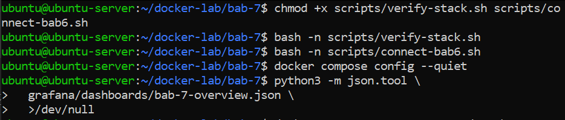  

---

### 15. Pemeriksaan dan Pengujian Konfigurasi Prometheus
**Penjelasan:**  
mengeksekusi utilitas promtool secara berurutan untuk memvalidasi sintaks file konfigurasi utama prometheus.yml, lalu dilanjutkan dengan menguji unit aturan alert pada rules.test.yml langsung di dalam kontainer Prometheus tanpa memuat layanan lain.

**Command:**
```bash
docker compose run --rm --no-deps \
  --entrypoint /bin/promtool \
  prometheus \
  check config /etc/prometheus/prometheus.yml

docker compose run --rm --no-deps \
  --entrypoint /bin/promtool \
  prometheus \
  test rules /etc/prometheus/tests/rules.test.yml
```

**Output:**  
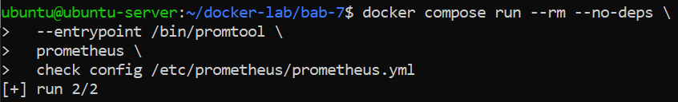  
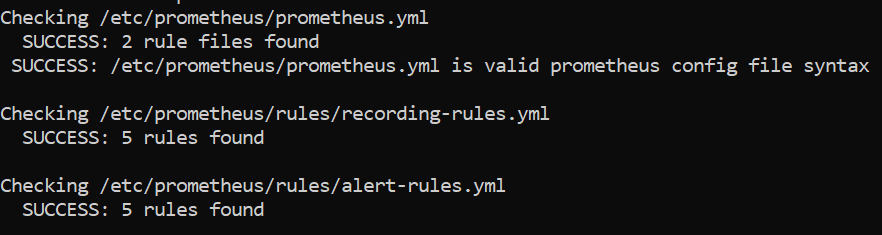  
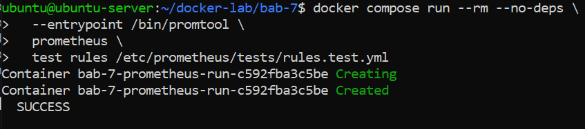  

---

### 16. Menjalankan Docker Compose Stack (Prometheus & Grafana)
**Penjelasan:**  
memperbarui citra kontainer ke versi terbaru, menjalankannya secara background, menampilkan status keaktifan kontainer, dan mengeksekusi skrip verifikasi untuk memastikan seluruh stack layanan berjalan normal.

**Command:**
```bash
docker compose pull
docker compose up -d
docker compose ps
./scripts/verify-stack.sh
```

**Output:**  
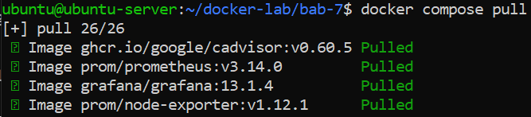  
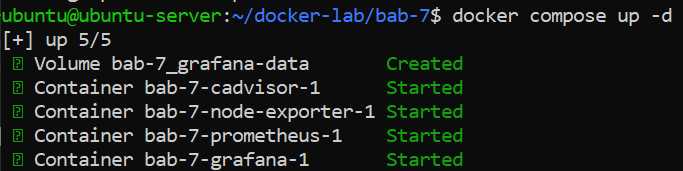
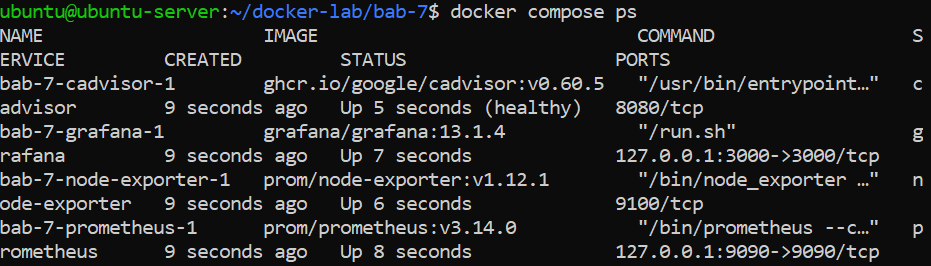
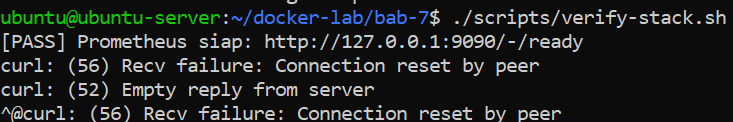
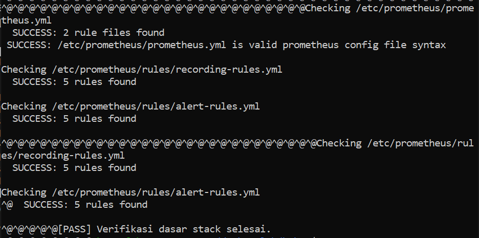

---

### 17. Akses Grafana Dashboard dan Prometheus
**Penjelasan:**  
Melakukan perintah ssh di windows agar port 3000 dan 9090 bisa terhubung dari vm. Lalu pada browser host buka localhost kedua port dan login pada akun sesuai .env yang dikonfigurasi. Untuk grafana masuk ke halaman dashboard -> DevSecOps Lab -> Bab 7

**Command:**
```bash
ssh -L 3000:localhost:3000 -L 9090:localhost:9090 username@ip_address_ubuntu_vm
```

**Output:**  
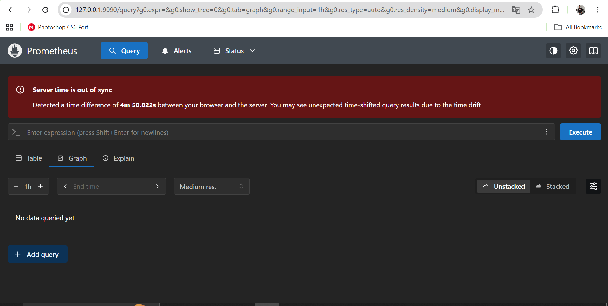  
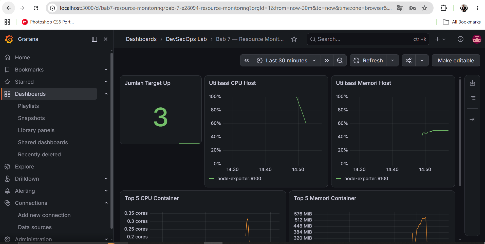 

---

### 18. Pemantauan Kinerja Sumber Daya Sistem
**Penjelasan:**  
memantau performa klaster secara real-time. Dua baris pertama menghitung persentase penggunaan CPU dan memori per instance node server, sedangkan dua baris berikutnya menampilkan lima kontainer teratas yang paling banyak mengonsumsi kapasitas CPU berdasarkan tingkat penggunaan per menit serta penggunaan memori aktif berbasis working set bytes.

**Command:**
```bash
up
instance:node_cpu_utilisation:ratio_rate5m * 100
instance:node_memory_utilisation:ratio * 100
topk(5, container:cpu_usage_cores:rate1m)
topk(5, container:memory_working_set_bytes:sum)
```

**Output:**   
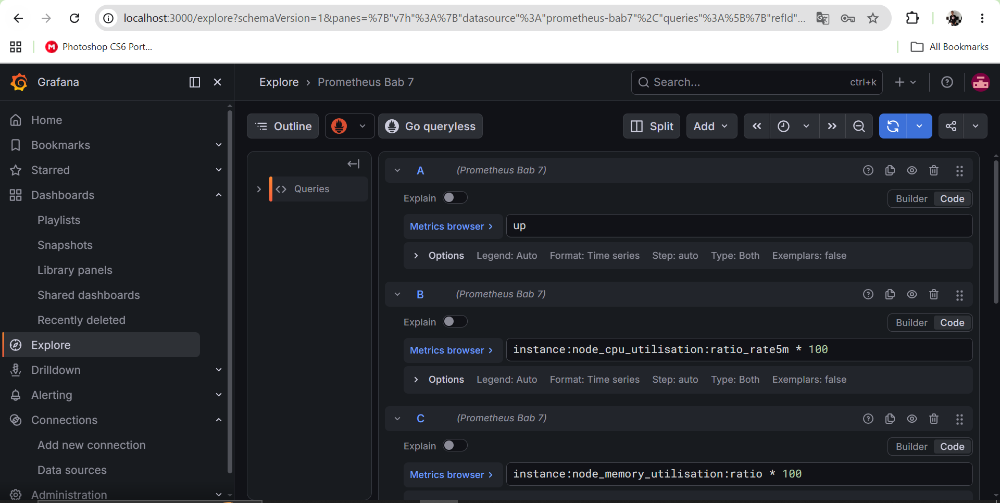  
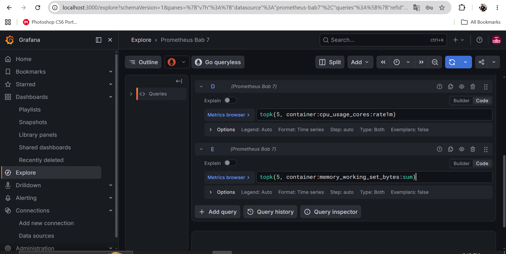  
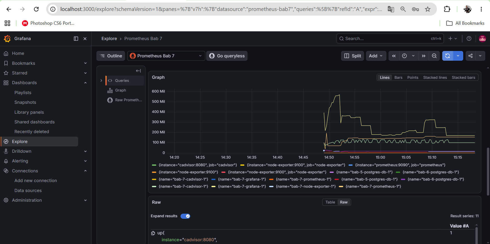  
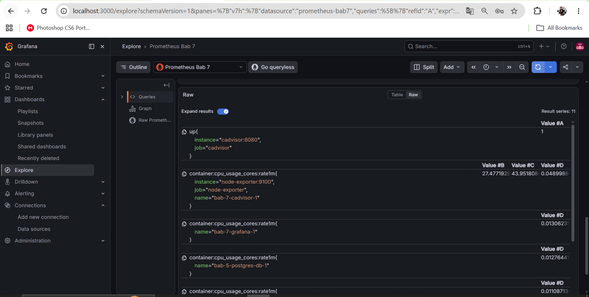  
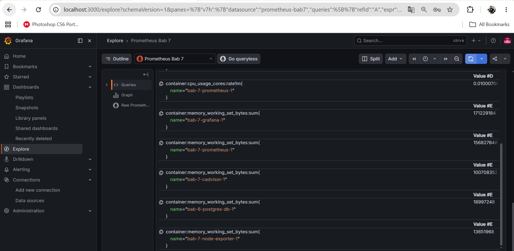

---

### 19. Simulasi Beban dan Pemantauan Peringatan Sistem
**Penjelasan:**  
menguji performa sistem secara simulasi. Langkah pertama mengaktifkan profil beban khusus dan menjalankan kontainer pembuat beban (load-generator), diikuti dengan kueri Prometheus untuk mengukur penggunaan inti CPU kontainer tersebut serta memeriksa status aktif dari aturan peringatan (alert) ContainerHighCPU, dan diakhiri dengan perintah untuk menghentikan serta menghapus kontainer simulasi tersebut setelah selesai. Untuk run queri dilakukan 2x dengan jeda sekitar 2 menit

**Command:**
```bash
docker compose --profile load up -d load-generator

container:cpu_usage_cores:rate1m{name=~".*load-generator.*"}
ALERTS{alertname="ContainerHighCPU"}

docker compose --profile load stop load-generator
docker compose --profile load rm -f load-generator
```

**Output:**    
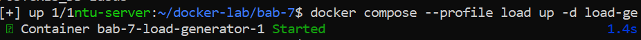  
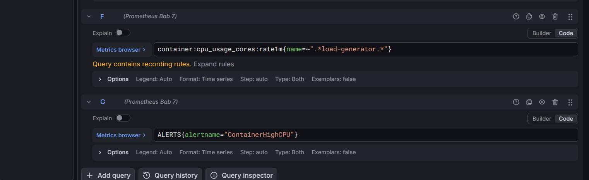  
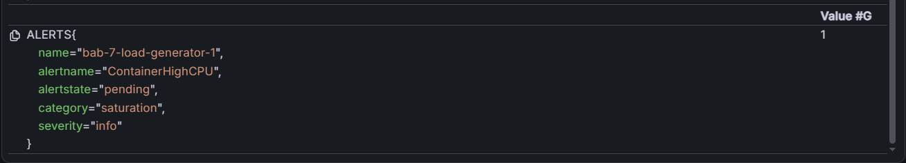  
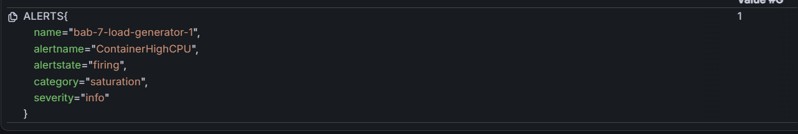  
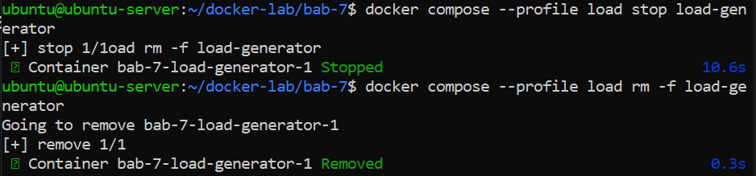

---

### 20. Simulasi Pemadaman dan Pemantauan Target Down
**Penjelasan:**  
Menguji sistem pemantauan ketersediaan layanan dengan cara menghentikan kontainer node-exporter secara sengaja, lalu setelah jeda 75 detik memeriksa kueri metrik ketersediaan target di Prometheus, melihat status aktif peringatan (alert) TargetDown yang berstatus firing, dan terakhir menghidupkan kembali kontainer tersebut.

**Command:**
```bash
docker compose stop node-exporter

up{job="node-exporter"}
ALERTS{alertname="TargetDown",alertstate="firing"}

docker compose start node-exporter
```

**Output:**     
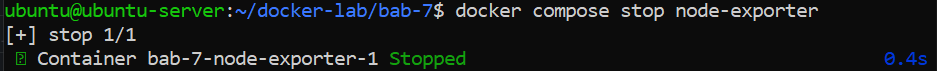  
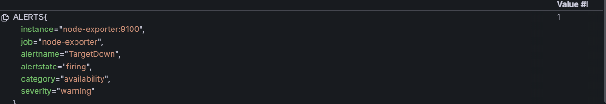  
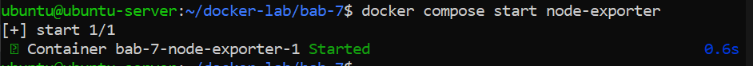 
 
---

### 21. Pengujian dan Kueri Log Sistem
**Penjelasan:**  
Skrip tersebut menjalankan koneksi untuk mengakses basis data atau lingkungan bab terkait, yang kemudian pada Grafana Explore, pilih datasource PostgreSQL Logs Bab 6 dan masukkan kueri SQL untuk mengambil data log dari tabel logs.fluentbit dengan memfilter berdasarkan rentang waktu, membersihkan nama kontainer, serta menampilkan kolom sumber dan pesan log secara terurut dari yang terbaru dengan batasan 200 baris.

**Command:**
```bash
./scripts/connect-bab6.sh

SELECT
    time AS "time",
    tag,
    replace(data ->> 'container_name', '/', '') AS container_name,
    data ->> 'source' AS source,
    data ->> 'log' AS log_message
FROM logs.fluentbit
WHERE $__timeFilter(time)
ORDER BY time DESC
LIMIT 200;
```

**Output:**     
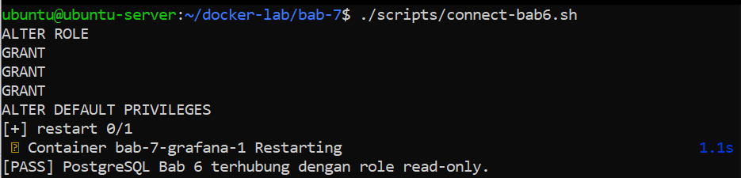  
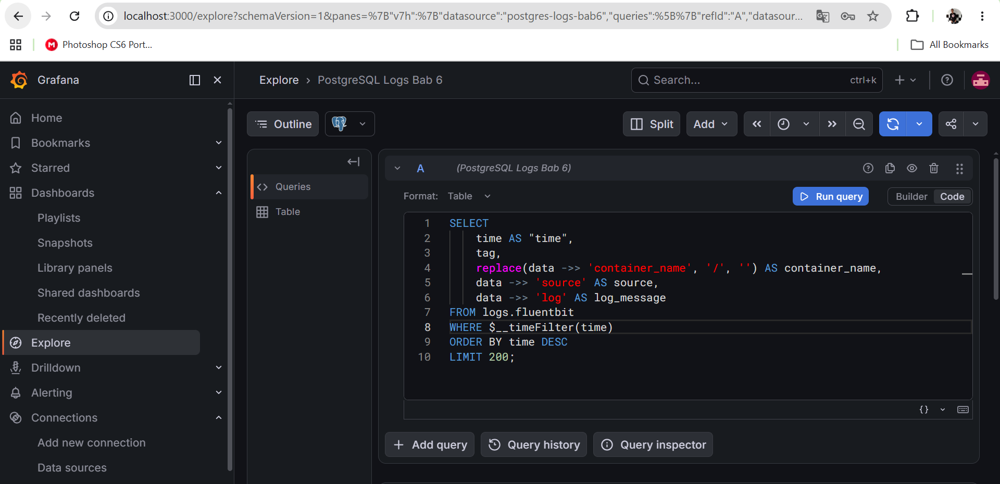  
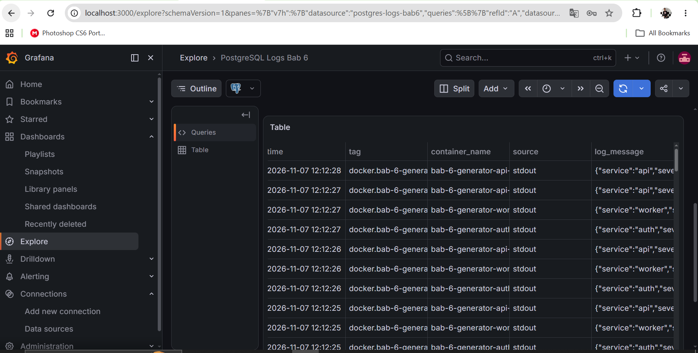
 
---